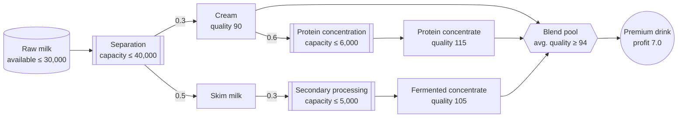
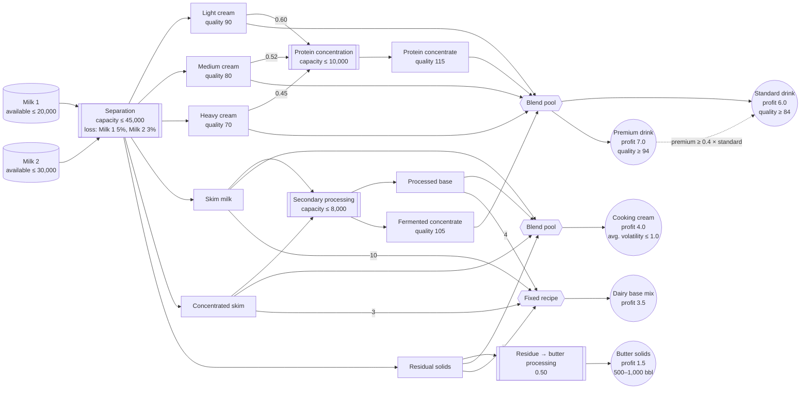

# 1. Building Optimization Models with Gurobi Modeler

If you have built optimization models before, you probably wrote the math by hand and then
translated it into `gurobipy` one line at a time. In this lab you will use the AI agents in
**Gurobi Intelligence Hub** instead: you describe the problem in plain language, and the agent
takes you from a model specification to a `gurobipy` implementation and its tests.

> ⚠️ There is no code to run in this document. All modeling work happens in your web browser at
> **[intelligence.gurobi.com](https://intelligence.gurobi.com)**.
> This document gives you the problem descriptions, a step-by-step guide, and expected results you
> can check your work against.

---

## What is Intelligence Hub?

Gurobi Intelligence Hub is a web service that brings Gurobi's AI agents together in one place.

| Agent | Status | Role |
|---|---|---|
| **Gurobot** | GA | Always-on expert for Gurobi products, syntax, and licensing |
| **Modeler** | Beta | Guides you from a business problem description to verified `gurobipy` code |
| **Explainer** | Experimental | Diagnoses and interprets an existing model instance (used in the next lab) |

All answers are grounded in Gurobi's official documentation, examples, and best practices, and
chats and files are isolated per session.

## What is Modeler?

**Modeler** is a modeling assistant that walks you step by step from a problem description to
verified, runnable `gurobipy` code.

- **Conversational specification**: It asks about the objective, constraints, inputs/outputs, and
  test scenarios one question at a time until the spec is complete.
- **Business-focused workflow**: It keeps you focused on the actual business problem rather than
  on the math.
- **Acceptance-test-driven verification**: It generates pytest test scenarios from the spec, runs
  them, checks pass/fail, and fixes the model itself when needed.
- **Iterative design**: When the problem changes, you update the spec and the AI carries the
  change through to the model and tests.

> 💡 **Note**: Modeler helps you build a *correct* model, but it does not guarantee the most
> *performant* one. Don't trust an AI-generated model blindly — get into the habit of checking it
> with small acceptance tests, as in the warm-up below.

## Lab Goals

This lab has three parts.

- **Part 0. Warm-up**: Hand Modeler a problem whose answer you already know, and get a feel for
  how to trust and verify an AI-built model.
- **Part 1. Main lab**: Describe a simplified problem — a dairy plant producing a single premium
  dairy drink — to Modeler, build a **production planning model that maximizes total profit**,
  and obtain a **feasible optimal solution**. This fits in about 30 minutes.
- **Appendix. Full process model**: A much more realistic version of the same plant. Try it if you
  have time or want a bigger challenge — the next lab (`2_Explainer`) uses this appendix model
  as-is.

## Part 0. Warm-up — Verify Modeler on a Problem You Already Know

Before tackling a new problem, give Modeler a **problem whose optimal answer is already known** and
compare its result against that answer. As stressed in the Modeler introduction, the way to build
trust in an AI-generated model is to check it on a small problem you can verify yourself.

**Problem**: A classic multi-period production and inventory planning problem (12 months, one
product). Its optimal total cost is known to be **4,250**.

The monthly demand, unit production cost, inventory holding cost, and production capacity are
provided in [`data/production_planning.csv`](data/production_planning.csv)
(columns: `month`, `demand`, `production_cost`, `holding_cost`, `production_capacity`).

### Sample Modeler Prompt

Paste the prompt below into the Intelligence Hub chat and attach `production_planning.csv`.
(Try describing the problem in your own words first, and expand this only if you get stuck.)

Show the prompt

> I want to optimize our plant's production and inventory plan for the next 12 months.
>
> We produce a single product every month, keep it in inventory, and use that inventory to meet
> each month's demand.
>
> Each month has a maximum production quantity (production capacity), and we can't produce more
> than that. Every unit we produce incurs a production cost, and every unsold unit left in
> inventory incurs a monthly holding cost. Both costs vary by month.
>
> Inventory carries over from the previous month, increases by what we produce this month, and
> decreases by this month's demand. We start the first month with zero inventory, and inventory
> can never go negative.
>
> The monthly demand, unit production cost, holding cost, and production capacity are in the
> attached CSV file (`production_planning.csv`).
>
> Build a monthly production plan that minimizes the total cost — production cost plus holding
> cost — over the full 12 months.

### Steps

1. Send the prompt above to **Modeler** in Intelligence Hub, with `production_planning.csv`
   attached.
2. Answer the questions Modeler asks to refine the spec, one at a time (for example: whether
   production quantities are integer or continuous, end-of-horizon inventory requirements, how to
   handle unmet demand).
3. Once the spec is complete, ask something like "**Show me the mathematical formulation first**",
   and check that the sets, variables, objective, and constraints Modeler wrote match what you
   described in words.
4. Then ask "**Implement it in gurobipy and optimize it with the attached CSV data**" to have the
   code generated and run.
5. Compare the **total cost (objective value)** and the monthly production and inventory levels
   against the known answer below.
6. If they differ, work out what is different and why through the conversation with Modeler
   (integer vs. continuous production quantities, how the initial inventory is handled in the
   inventory balance, and so on), and ask it to fix the model.

### Warm-up Expected Results

| Item | Known answer | Modeler result |
|---|---|---|
| Objective value (total cost, minimize) | 4,250.00 | **4,250.00** (should match) |
| January production / inventory | 40 / 0 | 40 / 0 |
| July production / inventory | 100 / 10 | 100 / 10 |
| Match? | - | ✅ Match |

## Part 1. Main Lab — Premium Dairy Drink Production Planning

Now that you know how to work with Modeler, model a **new problem whose answer you don't know yet**
together with Modeler, from scratch. (A much more realistic version of this plant is in the
appendix at the end of this document — Part 1 is simplified so you can finish it in 30 minutes.)

### Business Problem Description

A dairy plant buys raw milk and makes a single product: a **premium dairy drink**.

The separation unit splits raw milk into cream and skim milk. Cream can go straight into the drink,
or pass through the **protein concentration unit** to become a higher-quality protein concentrate.
Skim milk cannot be used in the drink on its own; it must go through the **secondary processing
unit**, which turns it into fermented concentrate that can be used as a drink ingredient.

The drink is made by blending these three ingredients (cream, protein concentrate, fermented
concentrate) by volume, and it can only be sold if its average quality index is **at least 94**.
(The quality index isn't a real nutrient label — it's a score that averages exactly by volume when
blended. For example, mixing equal parts of index 90 and index 115 gives exactly 102.5.)

| Stream | Yield (bbl/bbl) | Quality index |
|---|---|---|
| Cream (straight from separation) | 0.3 (per bbl of raw milk) | 90 |
| Skim milk (straight from separation) | 0.5 (per bbl of raw milk) | Not usable directly |
| Protein concentrate | 0.6 (per bbl of cream) | 115 |
| Fermented concentrate | 0.3 (per bbl of skim milk) | 105 |

| Unit / resource | Daily limit |
|---|---|
| Raw milk purchase | 30,000 barrels |
| Separation unit | 40,000 barrels |
| Protein concentration unit | 6,000 barrels |
| Secondary processing unit | 5,000 barrels |

The drink earns a profit of **7.0 (hundred dollars)** per barrel.

The diagram below shows how raw milk flows through separation and processing to become the premium
drink. Numbers next to the arrows are per-barrel yields.

**Goal**: Build a production plan that maximizes daily profit.

### Steps

Modeler does not take the whole problem description at once. It refines the spec by **asking one
question at a time**.

1. So don't explain everything up front. Start short, and answer Modeler's questions in order
   (process/yields, blending rules, sourcing, costs, capacity limits, sales conditions, and so on).
   (See "Sample Modeler Conversation" below for how the conversation actually flows.)
2. Once the spec is complete, ask something like "**Show me the mathematical formulation first**",
   and check that the sets, variables, objective, and constraints Modeler wrote match what you
   described in words.
3. Then ask "**Implement it in gurobipy and run the optimization**" to have the code generated
   and run.
4. Compare the **total profit (objective value)** and the usage of each unit against "Part 1
   Expected Results" below.
5. If they differ, work out what is different and why through the conversation with Modeler
   (direction of the material balance inequalities, direction of the quality constraint, unit
   capacity constraints, and so on), and ask it to fix the model. (The end of "Sample Modeler
   Conversation" below shows a real case of exactly this.)

### Part 1 Expected Results

Results from running the model Modeler generated. (Profit unit: hundreds of dollars = USD 100)

| Item | Value |
|---|---|
| Optimization Status | OPTIMAL |
| Total profit (objective value) | **70,210.84** |
| Raw milk used (≤ 30,000) | 30,000.00 (at limit) |
| Protein concentration unit used (≤ 6,000) | ≈ 1,174.70 (slack) |
| Secondary processing unit used (≤ 5,000) | 5,000.00 (at limit) |

| Stream | Amount (barrels) |
|---|---|
| Cream (blended directly) | ≈ 7,825.30 |
| Protein concentrate | ≈ 704.82 |
| Fermented concentrate | 1,500.00 |
| **Premium dairy drink (total output)** | ≈ 10,030.12 |

> ※ The variable names and implementation Modeler generates may differ from the above, but if the
> spec fully reflects the problem description in this document, the optimal value must be the same.
> If your value differs, check whether a constraint is missing from the spec or the implementation.

### Sample Modeler Conversation

Follow the "Steps" above. If you can't picture how the conversation actually goes, expand the
example below. (Try leading the conversation yourself first, and expand it only if you get stuck.)

Show the sample conversation

> **You**: I want to optimize the daily production plan for our dairy plant. We buy raw milk and
> make a single premium dairy drink. Can you help?

Modeler doesn't jump straight into a spec. It starts with a multiple-choice question to pin down the
objective (e.g., "Is this closest to cost minimization / revenue maximization / profit maximization
/ output maximization?").

> **You**: Profit maximization. Here's the process: when we put raw milk through the separation
> unit, we get cream and skim milk. Each barrel of raw milk yields 0.3 barrels of cream and 0.5
> barrels of skim milk; the rest is process loss.

Modeler: "What is the drink's recipe? Is it a fixed-ratio blend, or a flexible blend that only has
to meet a quality standard?"

> **You**: We blend three ingredients — cream, protein concentrate, and fermented concentrate — freely
> by volume, but the average quality index must be at least 94 to sell it. Cream itself has a
> quality index of 90. If we send cream through the protein concentration unit, it becomes protein
> concentrate with a quality index of 115, at 0.6 barrels per barrel of cream.

Modeler: "How is the fermented concentrate made? Is it purchased externally, or made by processing
skim milk? Please also give its quality index."

> **You**: Skim milk can't be used in the drink directly. It has to go through the secondary
> processing unit to become fermented concentrate with a quality index of 105, which is then used
> in the drink. One barrel of skim milk yields 0.3 barrels of fermented concentrate.

Modeler then asks about the cost and price structure.

> **You**: There are no separate cost items; all we know is that the drink earns a net profit of
> 7.0 (hundred dollars) per barrel. So just maximize drink output × 7.0.

Modeler: "Is there a limit on how much raw milk you can buy per day, or on unit processing
capacities?"

> **You**: Both. We can buy up to 30,000 barrels of raw milk per day, and the separation unit can
> process up to 40,000 barrels per day. The protein concentration unit can handle 6,000 barrels per
> day, and the secondary processing unit 5,000 barrels per day.

Modeler then checks a detail or two more, such as "Can all of the drink you produce be sold?" or
"Are there any additional constraints on blending ratios?" — for this problem, a short answer like
"Yes, everything can be sold, and there are no ratio constraints — it just needs a quality index of
94" is enough.

Once the spec feels complete, don't ask for code yet — check the mathematical formulation first.

> **You**: Great. Before implementing, show me the mathematical formulation first (sets, variables,
> objective, constraints).

Modeler lays out the complete formulation as below. Compare it item by item against what you
described in words.

**Decision variables (7)**

| Variable | Meaning |
|---|---|
| $x$ | Raw milk purchased per day (barrels) |
| $c_b$ | Cream sent directly to blending |
| $c_p$ | Cream sent to the protein concentration unit |
| $p$ | Protein concentrate produced |
| $s$ | Skim milk sent to the fermentation (secondary processing) unit |
| $f$ | Fermented concentrate produced |
| $b$ | Premium drink produced |

**Objective**

$$\max \quad 7.0 \cdot b$$

**Constraints**

$$x \leq 30{,}000 \quad \text{(C1: raw milk purchase limit)}$$

$$x \leq 40{,}000 \quad \text{(C2: separation capacity — effectively non-binding given C1)}$$

$$c_p \leq 6{,}000 \quad \text{(C3: protein concentration capacity)}$$

$$s \leq 5{,}000 \quad \text{(C4: fermentation unit capacity)}$$

$$c_b + c_p = 0.3x \quad \text{(C5: cream material balance)}$$

$$s = 0.5x \quad \text{(C6: skim milk material balance)}$$

$$p = 0.6 \cdot c_p \quad \text{(C7: protein concentrate balance)}$$

$$f = 0.3 \cdot s \quad \text{(C8: fermented concentrate balance)}$$

$$b = c_b + p + f \quad \text{(C9: drink output balance)}$$

$$-4 \cdot c_b + 21 \cdot p + 11 \cdot f \geq 0 \quad \text{(C10: linearization of the quality requirement } \tfrac{90c_b+115p+105f}{b}\geq 94 \text{)}$$

$$x, c_b, c_p, p, s, f, b \geq 0 \quad \text{(C11: non-negativity)}$$

Once you've confirmed the formulation matches your description, ask for the implementation.

> **You**: The formulation looks right. Implement it in gurobipy and run the optimization.

Result of the code Modeler ran: profit 31,500 (hundred dollars), 4,500 barrels of premium drink,
10,000 barrels of raw milk purchased (only 1/3 of the 30,000 limit), and the secondary processing
unit running at its full 5,000 barrels.

> **You**: Wait, raw milk purchases didn't reach the limit (30,000 barrels)? Can't we just process
> as much skim milk as the secondary processing unit can handle and discard the rest? We don't
> have to process 100% of the skim milk.

When Modeler takes another look, it finds that **C5 and C6 in the formulation above were written as
equalities, not inequalities** (`c_b + c_p = 0.3x`, `s = 0.5x`). In other words, a constraint
saying "all separated cream and skim milk must be used" had crept into the spec implicitly. Keeping
the other constraints (C1–C4, C7–C11) unchanged, only C5 and C6 are changed from equalities (`=`)
to inequalities (`≤`, i.e., "you can use up to what is produced, but you don't have to use all of
it"):

$$c_b + c_p \leq 0.3x \quad \text{(C5 revised: cream material balance — surplus cream may be discarded)}$$

$$s \leq 0.5x \quad \text{(C6 revised: skim milk material balance — surplus skim milk may be discarded)}$$

The new result after the fix and re-optimization: profit 70,210.84, 10,030 barrels of premium drink,
30,000 barrels of raw milk purchased (at the limit).

> ※ In your own session, the order and exact wording of Modeler's questions may differ from the
> example above. What matters is the flow — filling in "objective → process/yields → quality
> constraints → capacity constraints → sales conditions" — not the exact phrasing. The last part
> of the conversation above (raw milk not reaching its limit), however, is a real case we hit while
> preparing this document. Don't take Modeler's model at face value: get into the habit of checking
> for any unit whose usage looks suspiciously low.

---

## Appendix. Full Dairy Plant Process Model

Part 1 was a heavily simplified version of this plant. In reality there are **two types** of raw
milk, cream comes in **three grades** (light, medium, heavy), and there are **five** final products
(standard/premium dairy drink, cooking cream, dairy base mix, butter solids). Below is the full
version.

> 📌 The next lab (`2_Explainer`) **uses this appendix model as-is.** If you have time or want a
> bigger challenge, build it yourself with Modeler. Even if you don't, read through the problem
> description below — it is the background you need for the next lab.

### Business Problem Description

A dairy processor buys **two types of raw milk** (Milk 1, Milk 2) from different suppliers and runs
them through the following **four-stage process** to make **five consumer dairy products and
ingredients** with different margins.

1. Separation — split raw milk into 6 components: 3 cream grades + 2 skim streams + residue
2. Protein Concentration — turn cream into high-quality protein concentrate
3. Secondary Processing — turn the skim streams into processed base and fermented concentrate
4. Product Blending — blend the above ingredients into five final products

> 💡 One key concept first. The **quality index** below is not an actual nutrient label (fat or
> protein content); it is an **abstract score that averages exactly by volume when blended**
> (e.g., mixing equal parts of index 90 and index 70 gives exactly 80). Drinkable dairy products
> can only be sold if this index meets a threshold (84 or 94), but the cream you get from
> separating raw milk only reaches 70–90. That is why stages 2 and 3 use dedicated units to further
> process cream and skim milk into higher-quality ingredients with an index of 105–115 — but those
> units have fixed daily capacities, so "how much to process to raise quality" is the central
> trade-off of the whole problem.

**Stage 1 — Separation**: Raw milk is split into 6 components by centrifugation and filtration. The
yields per barrel of raw milk (including process losses of about 5% for Milk 1 and about 3% for
Milk 2) and the quality indices of the three cream grades are as follows. (The skim streams cannot
be used in drinkable products directly, and the residue is the solid leftover after centrifugation.)

| Component | Milk 1 yield | Milk 2 yield | Quality index |
|---|---|---|---|
| Light Cream | 0.10 | 0.15 | 90 |
| Medium Cream | 0.20 | 0.25 | 80 |
| Heavy Cream | 0.20 | 0.18 | 70 |
| Skim Milk | 0.12 | 0.08 | Not usable directly |
| Concentrated Skim | 0.20 | 0.19 | Not usable directly |
| Residual Solids | 0.13 | 0.12 | — (butter processing only) |

**Stage 2 — Protein Concentration**: The three cream fractions can go directly into blending, or
through the **protein concentration unit** (ultrafiltration — a process that uses a fine membrane to
filter out water and concentrate the protein) to become high-protein concentrate with a quality
index of **115**.

| Input | Protein concentrate yield (bbl/bbl) |
|---|---|
| Light Cream | 0.60 |
| Medium Cream | 0.52 |
| Heavy Cream | 0.45 |

**Stage 3 — Secondary Processing**: Skim milk and concentrated skim can go directly into blending,
or through the **secondary processing unit** to become processed base and fermented concentrate (a
concentrate fermented with lactic acid bacteria, quality index **105**). Residual solids can
separately be processed into butter-equivalent solids.

| Input | Processed base yield | Fermented concentrate yield |
|---|---|---|
| Skim Milk | 0.68 | 0.28 |
| Concentrated Skim | 0.75 | 0.20 |

| Input | Butter solids yield |
|---|---|
| Residual Solids | 0.50 |

**Stage 4 — Blending**: The ingredients above are blended into five final products. All blended
indices (quality index, volatility index) are computed the same way as in the callout above (linear
average by volume).

| Product | Blend ingredients | Quality / constraints |
|---|---|---|
| Premium Dairy Drink | 3 cream grades + protein concentrate + fermented concentrate (free blend) | Quality index ≥ 94 |
| Standard Dairy Drink | Same as above | Quality index ≥ 84; Premium output ≥ 0.4 × Standard output |
| Cooking Cream | Skim milk + concentrated skim + processed base + residue (free blend) | Volatility index ≤ 1.0 (table below) |
| Dairy Base Mix | Skim milk : processed base : concentrated skim : residue = 10 : 4 : 3 : 1 (fixed ratio) | — |
| Butter Solids | Processed residue | Daily output 500 – 1,000 barrels |

| Cooking Cream ingredient | Volatility index |
|---|---|
| Skim Milk | 1.0 |
| Concentrated Skim | 0.6 |
| Processed Base | 1.5 |
| Residue | 0.05 |

**Daily unit and resource limits**

| Unit / resource | Daily limit |
|---|---|
| Milk 1 purchase | 20,000 barrels |
| Milk 2 purchase | 30,000 barrels |
| Separation unit | 45,000 barrels |
| Protein concentration unit | 10,000 barrels |
| Secondary processing unit | 8,000 barrels |

**Profit contribution (per barrel, in hundreds of dollars)**

| Product | Profit |
|---|---|
| Premium Dairy Drink | 7.0 |
| Standard Dairy Drink | 6.0 |
| Cooking Cream | 4.0 |
| Dairy Base Mix | 3.5 |
| Butter Solids | 1.5 |

The diagram below shows the full flow from the two raw milks through separation and processing to
the five final products. Numbers next to the streams are per-barrel yields, and the constraints each
final product must satisfy are shown inside its node (the dashed line marks a constraint spanning two
different products, such as the ratio constraint between premium and standard drinks).

**Goal**: Build a daily production plan that maximizes the total profit of the five final products
above.

### Steps

As in Part 1, Modeler does not take the whole problem description at once. It refines the spec by
**asking one question at a time**.

1. Don't explain the whole "Business Problem Description" above at once. Start short, and answer
   Modeler's questions in order (separation yields per raw milk, protein concentration and
   secondary processing, how each of the five products is blended, capacity limits, sales
   conditions, and so on). (See "Sample Modeler Conversation" below for how the conversation
   actually flows.)
2. Once the spec is complete, ask something like "**Show me the mathematical formulation first**",
   and check that the sets, variables, objective, and constraints Modeler wrote match what you
   described in words.
3. Then ask "**Implement it in gurobipy and run the optimization**" to have the code generated
   and run.
4. Compare the **total profit (objective value)** and the output of each product against "Appendix
   Expected Results" below. Pay special attention to these easy-to-miss items:
   - Variables exist for all five final products (Premium/Standard drink, Cooking cream, Dairy base
     mix, Butter solids)
   - Butter Solids output is between 500 and 1,000 barrels
   - Premium Dairy Drink ≥ 0.4 × Standard Dairy Drink holds
   - Milk 1 usage ≤ 20,000 and Milk 2 usage ≤ 30,000
5. If they differ, work out what is different and why through the conversation with Modeler
   (direction of the material balance inequalities, blending and ratio constraints, quality and
   volatility constraints, unit capacity constraints, and so on), and ask it to fix the model.
6. The next lab (`2_Explainer`) uses this model as-is, so add `model.write("moodel.lp")` at the end
   of the code, run it, and keep the generated LP file.

### Appendix Expected Results

Results from running the model Modeler generated. (Profit unit: hundreds of dollars = USD 100)

| Item | Value |
|---|---|
| Optimization Status | OPTIMAL |
| Total profit (objective value) | **211,365.13** |
| Milk 1 used (≤ 20,000) | 15,000.00 (slack) |
| Milk 2 used (≤ 30,000) | 30,000.00 (at limit) |

| Final product | Output (barrels) | Profit contribution (hundreds of dollars) |
|---|---|---|
| Premium Dairy Drink | 6,817.78 | 47,724.45 |
| Standard Dairy Drink | 17,044.45 | 102,266.68 |
| Cooking Cream | 15,156.00 | 60,624.00 |
| Dairy Base Mix | 0.00 | 0.00 |
| Butter Solids | 500.00 | 750.00 |

> ※ The variable names and implementation Modeler generates may differ from the above, but if the
> spec fully reflects the problem description in this document, the optimal value must be the same.
> If your value differs, check whether a constraint is missing from the spec or the implementation.

### Sample Modeler Conversation

Below is a real end-to-end session in which this problem was modeled from scratch by calling
Intelligence Hub's Modeler API (lightly edited for wording; the order and content of questions and
answers are the same as in the actual session). Try leading the conversation yourself first, and
expand this only if you get stuck.

Show the sample conversation

> **You**: I want to optimize the daily production plan for our dairy processing business. We buy
> two types of raw milk and make five final products. Can you help?

Modeler doesn't jump straight into a spec. It starts with a multiple-choice question to pin down the
objective ("Is this closest to profit maximization / cost minimization / output maximization /
other?").

> **You**: Profit maximization (there's no raw milk purchase cost — only consider sales profit). We
> buy two types of raw milk, Milk 1 and Milk 2. The separation unit splits them into 6 components:
> light, medium, and heavy cream, skim milk, concentrated skim, and residue. (Share the yield and
> quality index table per raw milk — along with the note that the quality index is a linear average
> by volume.)

Modeler: "What are the 5 final products? Please tell me which components go into each product, and
the unit price (selling price per barrel)."

> **You**: First, there are two more processing stages after separation: the protein concentration
> unit (cream → protein concentrate with quality index 115, 10,000 barrels/day limit) and the
> secondary processing unit (skim streams → processed base + fermented concentrate, 8,000
> barrels/day limit). Residue is processed straight into butter solids. Now the 5 final products:
> Premium/Standard Dairy Drink (free blend + quality index constraint + 40% ratio constraint),
> Cooking Cream (free blend + volatility index constraint), Dairy Base Mix (10:4:3:1 fixed ratio),
> and Butter Solids (500–1,000 barrel range). (Share the yield, quality, and profit numbers.)

Modeler: "How is any unused surplus of the separated components handled? Please choose: **disposal
allowed** / must use everything / disposal incurs a cost / depends on the component."

> 💡 **Side note**: This question is the key fork in the conversation — it is exactly the issue you
> hit in Part 1 ("must all of the separated cream and skim milk be used?"), and this time Modeler
> asked about it before implementing.

> **You**: Disposal is allowed. Any surplus at any stage — separation, protein concentration, or
> secondary processing — can simply be discarded; there's no need to force full use.

Modeler: "For components with multiple uses, like residue, can they be freely allocated among those
uses?"

> **You**: Yes, free allocation. The 3 creams, the skim streams, and the residue can all be split
> among their uses (direct blending, further processing, other final products) however the
> optimization wants.

Modeler: "Are there separate minimum/maximum output constraints for Premium/Standard/Cooking
Cream/Dairy Base Mix?"

> **You**: None. The Premium ≥ 0.4 × Standard ratio constraint and the 500–1,000 barrel range for
> Butter Solids I mentioned are the only output-related constraints. You can also assume that
> everything produced can be sold.

Once the spec feels complete, don't ask for code yet — check the mathematical formulation first.

> **You**: Before implementing, show me the mathematical formulation first (sets, variables,
> objective, constraints).

Here is the formulation Modeler produced (sets: $K$ = 3 creams {LC, MC, HC}, $S$ = skim streams
{SM, CS}, $M$ = {Milk1, Milk2}).

**Decision variables**

| Variable | Meaning |
|---|---|
| $x_m$ | Amount of raw milk $m$ procured |
| $u^{blend}_k,\ u^{PC}_k$ | Cream $k$ sent directly to blending / to the protein concentration unit |
| $w^{blend}_s,\ w^{SP}_s$ | Skim stream $s$ sent directly to blending / to the secondary processing unit |
| $r^{CC},\ r^{DBM},\ r^{BS}$ | Residue allocated to Cooking Cream / Dairy Base Mix / butter processing |
| $b^{PRE}_i,\ b^{STD}_i$ | Amount of ingredient $i$ blended into the Premium/Standard drink ($i \in \{LC,MC,HC,PC,FC\}$) |
| $b^{CC}_i,\ b^{DBM}_i$ | Amount of ingredient $i$ blended into Cooking Cream / Dairy Base Mix |
| $\lambda$ | Scale variable for the Dairy Base Mix fixed ratio (10:4:3:1) |
| $\text{Vol}_p$ | Total output of final product $p$ ($p \in \{PRE,STD,CC,DBM,BS\}$) |

Besides the decision variables, the constraints below also use the following **parameters** (fixed
values). All values are exactly those in the tables in "Business Problem Description" above.

| Symbol | Meaning | Value |
|---|---|---|
| $y_{c,m}$ | Separation yield of component $c$ per barrel of raw milk $m$ | "Stage 1 — Separation" table |
| $\alpha^{PC}_k,\ \beta^{PB}_s,\ \beta^{FC}_s,\ \alpha^{BS}$ | Yields of cream $k$ → protein concentrate, skim stream $s$ → processed base / fermented concentrate, residue → butter solids | "Stage 2 · 3" tables |
| $q_i$ | Quality index of blend ingredient $i$ (LC 90, MC 80, HC 70, PC 115, FC 105) | "Stage 1 · 2 · 3" tables |
| $v_i$ | Volatility index of Cooking Cream ingredient $i$ (SM 1.0, CS 0.6, PB 1.5, RS 0.05) | "Stage 4 — Blending" table |

**Objective**

$$\max \quad Z = 7.0\,\text{Vol}&#95;{PRE} + 6.0\,\text{Vol}&#95;{STD} + 4.0\,\text{Vol}&#95;{CC} + 3.5\,\text{Vol}&#95;{DBM} + 1.5\,\text{Vol}&#95;{BS}$$

**Constraints**

$$x_{Milk1} \leq 20{,}000, \quad x_{Milk2} \leq 30{,}000 \quad \text{(C1: raw milk procurement limits)}$$

$$\textstyle\sum_{m} x_m \leq 45{,}000 \quad \text{(C2: separation capacity)}$$

$$u^{blend}&#95;k + u^{PC}&#95;k \leq \textstyle\sum_{m} y_{k,m}\,x_m \quad \forall k \in K \quad \text{(C3a: cream material balance — surplus may be discarded)}$$

$$w^{blend}&#95;s + w^{SP}&#95;s \leq \textstyle\sum_{m} y_{s,m}\,x_m \quad \forall s \in S \quad \text{(C3b: skim stream material balance)}$$

$$r^{CC}+r^{DBM}+r^{BS} \leq \textstyle\sum_{m} y_{RS,m}\,x_m \quad \text{(C3c: residue material balance)}$$

$$\textstyle\sum_{k} u^{PC}&#95;k \leq 10{,}000 \quad \text{(C4: protein concentration capacity)}$$

$$\textstyle\sum_{s} w^{SP}&#95;s \leq 8{,}000 \quad \text{(C5: secondary processing capacity)}$$

$$b^{PRE}&#95;k + b^{STD}&#95;k \leq u^{blend}&#95;k \quad \forall k \in K \quad \text{(C6a: cream available for drinks)}$$

$$b^{PRE}&#95;{PC} + b^{STD}&#95;{PC} \leq \textstyle\sum_{k} \alpha^{PC}&#95;k\,u^{PC}&#95;k \quad \text{(C6b: protein concentrate available for drinks)}$$

$$b^{PRE}&#95;{FC} + b^{STD}&#95;{FC} \leq \textstyle\sum_{s} \beta^{FC}&#95;s\,w^{SP}&#95;s \quad \text{(C6c: fermented concentrate available for drinks)}$$

$$b^{CC}&#95;s + b^{DBM}&#95;s \leq w^{blend}&#95;s \quad \forall s \in S \quad \text{(C7a: skim streams available for Cooking Cream/DBM)}$$

$$b^{CC}&#95;{PB} + b^{DBM}&#95;{PB} \leq \textstyle\sum_{s} \beta^{PB}&#95;s\,w^{SP}&#95;s \quad \text{(C7b: processed base available)}$$

$$\textstyle\sum_i (q_i - 94)\,b^{PRE}&#95;i \geq 0 \quad \text{(C8: linearization of Premium quality index} \geq 94 \text{)}$$

$$\textstyle\sum_i (q_i - 84)\,b^{STD}&#95;i \geq 0 \quad \text{(C9: linearization of Standard quality index} \geq 84 \text{)}$$

$$\text{Vol}&#95;{PRE} \geq 0.4\cdot\text{Vol}&#95;{STD} \quad \text{(C10: Premium} \geq 0.4\times\text{Standard ratio)}$$

$$\textstyle\sum_i (v_i - 1.0)\,b^{CC}&#95;i \leq 0 \quad \text{(C11: linearization of Cooking Cream volatility index} \leq 1.0 \text{)}$$

$$b^{DBM}&#95;{SM}=10\lambda,\ \ b^{DBM}&#95;{PB}=4\lambda,\ \ b^{DBM}&#95;{CS}=3\lambda,\ \ b^{DBM}&#95;{RS}=\lambda \quad \text{(C12: DBM fixed ratio 10:4:3:1)}$$

$$500 \leq 0.5\,r^{BS} \leq 1{,}000 \quad \text{(C13: Butter Solids output 500–1,000 barrels)}$$

$$\text{all variables} \geq 0 \quad \text{(C14: non-negativity)}$$

Each product's $\text{Vol}_p$ is **defined** as follows, without a constraint number (the
`math_formulation.md` Modeler actually produced also marks these only as "Def." without a Cn number).

$$\text{Vol}&#95;{PRE}=\textstyle\sum_i b^{PRE}&#95;i,\ \ \text{Vol}&#95;{STD}=\textstyle\sum_i b^{STD}&#95;i,\ \ \text{Vol}&#95;{CC}=\textstyle\sum_i b^{CC}&#95;i,\ \ \text{Vol}&#95;{DBM}=18\lambda,\ \ \text{Vol}&#95;{BS}=0.5\,r^{BS}$$

Also, $b^{CC}&#95;{RS}$ and $b^{DBM}&#95;{RS}$ (the residue actually blended into Cooking Cream/DBM)
cannot exceed $r^{CC}$ and $r^{DBM}$ (the residue allocated to each), respectively. This relationship
is already captured by C3c, so it isn't listed again as a separate constraint.

> 💡 **Side note**: Notice that the component availability constraints (C3a–c) are written as
> **inequalities**. In Part 1, this part was initially (and wrongly) written as equalities — "must
> use everything" — which kept raw milk usage below its limit. This time, Modeler asked "can the
> surplus be discarded?" before implementing, so it was right from the start.

> **You**: The formulation looks right. Implement it in gurobipy and run the optimization.

The code Modeler generated and ran matched "Appendix Expected Results" above exactly (total profit
211,365.13; Milk 1 15,000 / Milk 2 30,000 — hitting the 45,000-barrel separation limit; Premium
6,817.78 : Standard 17,044.45 = exactly 0.4; Butter Solids at its lower bound of 500.00).

> ※ In your own session, the order and exact wording of Modeler's questions may vary a little each
> time. What matters is the flow — filling in "objective → raw milk/separation → cream and skim
> processing → blending rules → surplus handling → capacity constraints" — not the exact phrasing.
> In particular, answer carefully when Modeler proactively asks something like "How is any unused
> surplus handled?" — in Part 1, this was never explicitly confirmed, which led to the
> equality/inequality mix-up.

## Coming Up Next

The feasible model you completed in the appendix carries straight over into the next lab,
`2_Explainer`. There, the **marketing team quietly adds a new requirement** to this model — if your
optimizer suddenly went infeasible one day, could you diagnose the cause and propose a fix?
