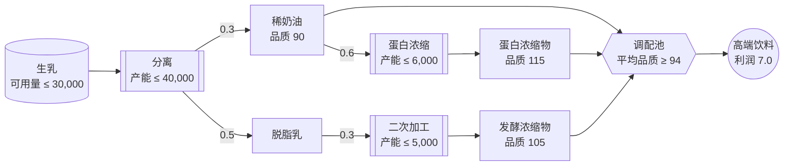
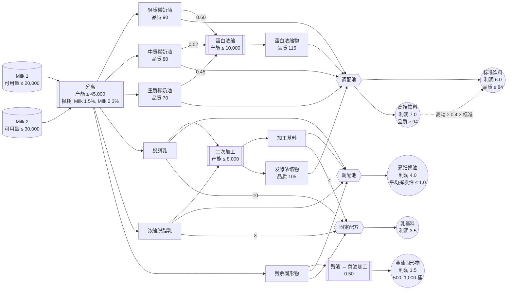

# 1. 使用 Gurobi Modeler 构建优化模型

如果你以前构建过优化模型，你很可能是先手写数学公式，再逐行将其转换为 `gurobipy` 代码。在本实验中，
你将改用 **Gurobi Intelligence Hub** 中的 AI 智能体：你用自然语言描述问题，智能体会带你从模型规格说明
一路走到 `gurobipy` 实现及其测试。

> ⚠️ 本文档中没有需要运行的代码。所有建模工作都在浏览器中的
> **[intelligence.gurobi.com](https://intelligence.gurobi.com)** 上完成。
> 本文档提供问题描述、分步指南，以及可用于核对结果的预期结果。

---

## 什么是 Intelligence Hub？

Gurobi Intelligence Hub 是一项 Web 服务，它将 Gurobi 的各个 AI 智能体集中在一处。

| 智能体 | 状态 | 作用 |
|---|---|---|
| **Gurobot** | GA | 随时在线的专家，解答 Gurobi 产品、语法和许可相关问题 |
| **Modeler** | Beta | 引导你从业务问题描述走到经过验证的 `gurobipy` 代码 |
| **Explainer** | Experimental | 诊断并解读已有的模型实例（在下一个实验中使用） |

所有回答都基于 Gurobi 官方文档、示例和最佳实践，且对话和文件按会话相互隔离。

## 什么是 Modeler？

**Modeler** 是一个建模助手，它会一步步引导你从问题描述得到经过验证、可直接运行的 `gurobipy` 代码。

- **对话式规格说明**：它会就目标、约束、输入/输出和测试场景逐一提问，直到规格说明完整为止。
- **以业务为中心的工作流**：它让你专注于实际的业务问题，而不是数学细节。
- **验收测试驱动的验证**：它根据规格说明生成 pytest 测试场景，运行测试、检查通过/失败，并在需要时
  自行修正模型。
- **迭代式设计**：当问题发生变化时，你只需更新规格说明，AI 会将变更同步到模型和测试中。

> 💡 **注意**：Modeler 帮助你构建*正确*的模型，但并不保证得到*性能最优*的模型。不要盲目相信 AI
> 生成的模型——要养成用小规模验收测试来检查模型的习惯，就像下面的热身环节那样。

## 实验目标

本实验分为三个部分。

- **第 0 部分：热身**：把一个你已经知道答案的问题交给 Modeler，体会如何信任并验证 AI 构建的模型。
- **第 1 部分：主实验**：向 Modeler 描述一个简化问题——一家只生产一种高端乳饮料的乳品厂——构建一个
  **以总利润最大化为目标的生产计划模型**，并得到**可行的最优解**。大约 30 分钟即可完成。
- **附录：完整工艺模型**：同一家工厂的一个更贴近实际的版本。如果你有时间或想挑战更大的问题，可以尝试
  ——下一个实验（`2_Explainer`）会直接使用这个附录模型。

## 第 0 部分：热身——在已知答案的问题上验证 Modeler

在处理新问题之前，先给 Modeler 一个**已知最优答案的问题**，并将其结果与该答案进行比较。正如 Modeler
介绍中所强调的，建立对 AI 生成模型的信任，方法就是在你能自行验证的小问题上进行检验。

**问题**：一个经典的多周期生产与库存计划问题（12 个月，单一产品）。已知其最优总成本为 **4,250**。

每月的需求、单位生产成本、库存持有成本和生产产能见
[`data/production_planning.csv`](../data/production_planning.csv)
（列：`month`、`demand`、`production_cost`、`holding_cost`、`production_capacity`）。

### Modeler 提示词示例

将下面的提示词粘贴到 Intelligence Hub 对话框中，并附上 `production_planning.csv`。
（建议先尝试用自己的话描述问题，实在卡住了再展开查看。）

显示提示词

> 我想优化我们工厂未来 12 个月的生产和库存计划。
>
> 我们每个月生产一种产品，将其存入库存，并用库存来满足每个月的需求。
>
> 每个月都有最大生产量（生产产能），产量不能超过该上限。每生产一单位产品都会产生生产成本，每一单位
> 留在库存中未售出的产品每月都会产生库存持有成本。这两项成本都随月份变化。
>
> 库存从上个月结转而来，加上本月的产量，再减去本月的需求。第一个月的期初库存为零，且库存不能为负。
>
> 每月的需求、单位生产成本、库存持有成本和生产产能见附件 CSV 文件（`production_planning.csv`）。
>
> 请制定一个月度生产计划，使 12 个月内的总成本（生产成本加库存持有成本）最小。

### 步骤

1. 在 Intelligence Hub 中将上述提示词发送给 **Modeler**，并附上 `production_planning.csv`。
2. 逐一回答 Modeler 为完善规格说明而提出的问题（例如：产量是整数还是连续变量、期末库存要求、如何处理
   未满足的需求）。
3. 规格说明完整后，提出类似“**请先给我看数学模型**”的请求，检查 Modeler 写出的集合、变量、目标和
   约束是否与你用文字描述的内容一致。
4. 然后提出“**请用 gurobipy 实现，并用附件中的 CSV 数据进行优化**”，让它生成并运行代码。
5. 将**总成本（目标值）** 以及各月的产量和库存水平与下方的已知答案进行比较。
6. 如果结果不一致，就通过与 Modeler 的对话找出差异所在及其原因（产量是整数还是连续、库存平衡中如何
   处理期初库存等），并让它修正模型。

### 热身预期结果

| 项目 | 已知答案 | Modeler 结果 |
|---|---|---|
| 目标值（总成本，最小化） | 4,250.00 | **4,250.00**（应一致） |
| 1 月产量 / 库存 | 40 / 0 | 40 / 0 |
| 7 月产量 / 库存 | 100 / 10 | 100 / 10 |
| 是否一致？ | - | ✅ 一致 |

## 第 1 部分：主实验——高端乳饮料生产计划

既然你已经了解了如何与 Modeler 协作，现在就和 Modeler 一起从零开始为一个**你尚不知道答案的新问题**
建模。（本文档末尾的附录中有这家工厂一个更贴近实际的版本——第 1 部分经过简化，以便你在 30 分钟内完成。）

### 业务问题描述

一家乳品厂采购生乳，只生产一种产品：**高端乳饮料（premium dairy drink）**。

分离装置将生乳分离为稀奶油（cream）和脱脂乳（skim milk）。稀奶油可以直接用于饮料，也可以经过
**蛋白浓缩装置**制成品质更高的蛋白浓缩物（protein concentrate）。脱脂乳不能单独用于饮料，必须经过
**二次加工装置**，转化为可用作饮料原料的发酵浓缩物（fermented concentrate）。

饮料由这三种原料（稀奶油、蛋白浓缩物、发酵浓缩物）按体积调配而成，且只有当其平均品质指数
**不低于 94** 时才能销售。（品质指数并不是真实的营养标签，而是一个在调配时严格按体积加权平均的分数。
例如，将指数 90 和指数 115 的原料等量混合，结果恰好是 102.5。）

| 物料流 | 收率（桶/桶） | 品质指数 |
|---|---|---|
| 稀奶油（分离后直接得到） | 0.3（每桶生乳） | 90 |
| 脱脂乳（分离后直接得到） | 0.5（每桶生乳） | 不可直接使用 |
| 蛋白浓缩物 | 0.6（每桶稀奶油） | 115 |
| 发酵浓缩物 | 0.3（每桶脱脂乳） | 105 |

| 装置 / 资源 | 每日上限 |
|---|---|
| 生乳采购 | 30,000 桶 |
| 分离装置 | 40,000 桶 |
| 蛋白浓缩装置 | 6,000 桶 |
| 二次加工装置 | 5,000 桶 |

该饮料每桶利润为 **7.0（百美元）**。

下图展示了生乳如何经过分离和加工最终成为高端饮料。箭头旁的数字为每桶收率。

**目标**：制定一个使每日利润最大化的生产计划。

### 步骤

Modeler 不会一次性接收整个问题描述，而是通过**每次提一个问题**的方式来逐步完善规格说明。

1. 所以不要一开始就把所有内容都讲清楚。先简短开场，然后按顺序回答 Modeler 的问题（工艺/收率、调配
   规则、原料来源、成本、产能上限、销售条件等）。
   （对话的实际进展方式请参见下方的“Modeler 对话示例”。）
2. 规格说明完整后，提出类似“**请先给我看数学模型**”的请求，检查 Modeler 写出的集合、变量、目标和
   约束是否与你用文字描述的内容一致。
3. 然后提出“**请用 gurobipy 实现并运行优化**”，让它生成并运行代码。
4. 将**总利润（目标值）** 以及各装置的使用量与下方的“第 1 部分预期结果”进行比较。
5. 如果结果不一致，就通过与 Modeler 的对话找出差异所在及其原因（物料平衡不等式的方向、品质约束的
   方向、装置产能约束等），并让它修正模型。（下方“Modeler 对话示例”的结尾恰好展示了这样一个真实
   案例。）

### 第 1 部分预期结果

运行 Modeler 所生成模型的结果。（利润单位：百美元（USD 100））

| 项目 | 数值 |
|---|---|
| 优化状态 | OPTIMAL |
| 总利润（目标值） | **70,210.84** |
| 生乳使用量（≤ 30,000） | 30,000.00（达到上限） |
| 蛋白浓缩装置使用量（≤ 6,000） | ≈ 1,174.70（有余量） |
| 二次加工装置使用量（≤ 5,000） | 5,000.00（达到上限） |

| 物料流 | 数量（桶） |
|---|---|
| 稀奶油（直接调配） | ≈ 7,825.30 |
| 蛋白浓缩物 | ≈ 704.82 |
| 发酵浓缩物 | 1,500.00 |
| **高端乳饮料（总产量）** | ≈ 10,030.12 |

> ※ Modeler 生成的变量名和实现方式可能与上述不同，但只要规格说明完整反映了本文档中的问题描述，
> 最优值就必定相同。如果你的结果不同，请检查规格说明或实现中是否遗漏了某个约束。

### Modeler 对话示例

请按照上面的“步骤”进行。如果你想象不出对话实际会如何进行，可以展开下面的示例。（建议先尝试自己主导
对话，实在卡住了再展开查看。）

显示对话示例

> **你**：我想优化我们乳品厂的每日生产计划。我们采购生乳，只生产一种高端乳饮料。你能帮忙吗？

Modeler 不会直接进入规格说明，而是先用一个选择题来确定目标（例如：“这更接近成本最小化 / 收入最大化
/ 利润最大化 / 产量最大化中的哪一种？”）。

> **你**：利润最大化。工艺是这样的：生乳经过分离装置后，得到稀奶油和脱脂乳。每桶生乳可得到 0.3 桶
> 稀奶油和 0.5 桶脱脂乳，其余为工艺损耗。

Modeler：“饮料的配方是什么？是固定比例调配，还是只需满足品质标准的灵活调配？”

> **你**：我们将稀奶油、蛋白浓缩物和发酵浓缩物这三种原料按体积自由调配，但平均品质指数必须不低于
> 94 才能销售。稀奶油本身的品质指数为 90。如果将稀奶油送入蛋白浓缩装置，每桶稀奶油可制得 0.6 桶
> 品质指数为 115 的蛋白浓缩物。

Modeler：“发酵浓缩物是如何得到的？是外部采购，还是由脱脂乳加工而来？另外请提供它的品质指数。”

> **你**：脱脂乳不能直接用于饮料。它必须经过二次加工装置，转化为品质指数为 105 的发酵浓缩物，再
> 用于饮料。每桶脱脂乳可得到 0.3 桶发酵浓缩物。

接着 Modeler 会询问成本和价格结构。

> **你**：没有单独的成本项，我们只知道饮料每桶净利润为 7.0（百美元）。所以只需最大化饮料产量 × 7.0。

Modeler：“每天可采购的生乳量是否有上限？各装置的处理产能是否有限制？”

> **你**：都有。我们每天最多可采购 30,000 桶生乳，分离装置每天最多可处理 40,000 桶。蛋白浓缩装置
> 每天可处理 6,000 桶，二次加工装置每天可处理 5,000 桶。

随后 Modeler 还会再确认一两个细节，比如“生产的饮料能否全部售出？”或“调配比例是否还有其他约束？”
——对于这个问题，简短回答“是的，都能卖出去，也没有比例约束——只要品质指数达到 94 即可”就足够了。

当规格说明看起来已经完整时，先不要急着要代码——先检查数学模型。

> **你**：很好。在实现之前，请先给我看数学模型（集合、变量、目标、约束）。

Modeler 会给出如下完整的数学模型。请将其与你用文字描述的内容逐项比对。

**决策变量（7 个）**

| 变量 | 含义 |
|---|---|
| $x$ | 每日生乳采购量（桶） |
| $c_b$ | 直接送去调配的稀奶油 |
| $c_p$ | 送入蛋白浓缩装置的稀奶油 |
| $p$ | 蛋白浓缩物产量 |
| $s$ | 送入发酵（二次加工）装置的脱脂乳 |
| $f$ | 发酵浓缩物产量 |
| $b$ | 高端饮料产量 |

**目标**

$$\max \quad 7.0 \cdot b$$

**约束**

$$x \leq 30{,}000 \quad \text{(C1: 生乳采购上限)}$$

$$x \leq 40{,}000 \quad \text{(C2: 分离产能——在 C1 下实际上不起作用)}$$

$$c_p \leq 6{,}000 \quad \text{(C3: 蛋白浓缩产能)}$$

$$s \leq 5{,}000 \quad \text{(C4: 发酵装置产能)}$$

$$c_b + c_p = 0.3x \quad \text{(C5: 稀奶油物料平衡)}$$

$$s = 0.5x \quad \text{(C6: 脱脂乳物料平衡)}$$

$$p = 0.6 \cdot c_p \quad \text{(C7: 蛋白浓缩物平衡)}$$

$$f = 0.3 \cdot s \quad \text{(C8: 发酵浓缩物平衡)}$$

$$b = c_b + p + f \quad \text{(C9: 饮料产量平衡)}$$

$$-4 \cdot c_b + 21 \cdot p + 11 \cdot f \geq 0 \quad \text{(C10: 品质要求的线性化 } \tfrac{90c_b+115p+105f}{b}\geq 94 \text{)}$$

$$x, c_b, c_p, p, s, f, b \geq 0 \quad \text{(C11: 非负性)}$$

确认数学模型与你的描述一致后，再请求实现。

> **你**：数学模型看起来没问题。请用 gurobipy 实现并运行优化。

Modeler 运行代码的结果：利润 31,500（百美元），高端饮料 4,500 桶，生乳采购 10,000 桶（仅为 30,000
上限的 1/3），二次加工装置满负荷运行于 5,000 桶。

> **你**：等一下，生乳采购量没有达到上限（30,000 桶）？我们难道不能只把二次加工装置能处理的脱脂乳
> 拿去加工，剩下的丢弃吗？我们并不需要把脱脂乳 100% 加工掉。

Modeler 重新检查后发现，**上面数学模型中的 C5 和 C6 被写成了等式，而不是不等式**（`c_b + c_p = 0.3x`、
`s = 0.5x`）。也就是说，“分离出的稀奶油和脱脂乳必须全部使用”这一约束被隐含地带进了规格说明。其他约束
（C1–C4、C7–C11）保持不变，只将 C5 和 C6 从等式（`=`）改为不等式（`≤`，即“最多可使用产出的量，
但不必全部用完”）：

$$c_b + c_p \leq 0.3x \quad \text{(C5 修正: 稀奶油物料平衡——多余稀奶油可丢弃)}$$

$$s \leq 0.5x \quad \text{(C6 修正: 脱脂乳物料平衡——多余脱脂乳可丢弃)}$$

修正并重新优化后的新结果：利润 70,210.84，高端饮料 10,030 桶，生乳采购 30,000 桶（达到上限）。

> ※ 在你自己的会话中，Modeler 提问的顺序和具体措辞可能与上例不同。重要的是流程——依次补全“目标 →
> 工艺/收率 → 品质约束 → 产能约束 → 销售条件”——而不是具体措辞。不过，上面对话的最后一部分（生乳
> 未达到上限）是我们在编写本文档时真实遇到的情况。不要对 Modeler 的模型照单全收：要养成习惯，检查
> 是否有哪个装置的使用量低得可疑。

---

## 附录：完整的乳品厂工艺模型

第 1 部分是这家工厂的高度简化版本。实际上，生乳有**两种**，稀奶油分为**三个等级**（轻质、中质、重质），
最终产品有**五种**（标准/高端乳饮料、烹饪奶油、乳基料、黄油固形物）。下面是完整版本。

> 📌 下一个实验（`2_Explainer`）**会直接使用这个附录模型**。如果你有时间或想挑战更大的问题，可以用
> Modeler 自己构建它。即使不做，也请通读下面的问题描述——这是下一个实验所需的背景知识。

### 业务问题描述

一家乳品加工企业从不同供应商处采购**两种生乳**（Milk 1、Milk 2），经过以下**四个阶段的工艺**，
生产出利润率各不相同的**五种消费乳制品及原料**。

1. 分离——将生乳分离为 6 种组分：3 个等级的稀奶油 + 2 种脱脂物料流 + 残渣
2. 蛋白浓缩——将稀奶油转化为高品质的蛋白浓缩物
3. 二次加工——将脱脂物料流转化为加工基料和发酵浓缩物
4. 产品调配——将上述原料调配成五种最终产品

> 💡 先介绍一个关键概念。下面的**品质指数**并不是实际的营养标签（脂肪或蛋白质含量），而是一个
> **在调配时严格按体积加权平均的抽象分数**（例如，将指数 90 和指数 70 等量混合，结果恰好是 80）。
> 可饮用乳制品只有在该指数达到阈值（84 或 94）时才能销售，但生乳分离得到的稀奶油只有 70–90。因此，
> 第 2 和第 3 阶段要用专用装置将稀奶油和脱脂乳进一步加工成指数为 105–115 的高品质原料——但这些装置
> 的每日产能是固定的，所以“为提高品质要加工多少”就是整个问题的核心权衡。

**第 1 阶段——分离**：生乳经离心和过滤分离为 6 种组分。每桶生乳的收率（Milk 1 约含 5%、Milk 2 约含
3% 的工艺损耗）以及三个等级稀奶油的品质指数如下。（脱脂物料流不能直接用于可饮用产品，残渣是离心后
剩余的固体。）

| 组分 | Milk 1 收率 | Milk 2 收率 | 品质指数 |
|---|---|---|---|
| 轻质稀奶油（Light Cream） | 0.10 | 0.15 | 90 |
| 中质稀奶油（Medium Cream） | 0.20 | 0.25 | 80 |
| 重质稀奶油（Heavy Cream） | 0.20 | 0.18 | 70 |
| 脱脂乳（Skim Milk） | 0.12 | 0.08 | 不可直接使用 |
| 浓缩脱脂乳（Concentrated Skim） | 0.20 | 0.19 | 不可直接使用 |
| 残余固形物（Residual Solids） | 0.13 | 0.12 | —（仅用于黄油加工） |

**第 2 阶段——蛋白浓缩**：三种稀奶油组分可以直接进入调配，也可以经过**蛋白浓缩装置**（超滤——一种
利用精细膜滤除水分、浓缩蛋白质的工艺）制成品质指数为 **115** 的高蛋白浓缩物。

| 输入 | 蛋白浓缩物收率（桶/桶） |
|---|---|
| 轻质稀奶油 | 0.60 |
| 中质稀奶油 | 0.52 |
| 重质稀奶油 | 0.45 |

**第 3 阶段——二次加工**：脱脂乳和浓缩脱脂乳可以直接进入调配，也可以经过**二次加工装置**制成加工基料
（processed base）和发酵浓缩物（经乳酸菌发酵的浓缩物，品质指数 **105**）。残余固形物可单独加工成
黄油当量固形物。

| 输入 | 加工基料收率 | 发酵浓缩物收率 |
|---|---|---|
| 脱脂乳 | 0.68 | 0.28 |
| 浓缩脱脂乳 | 0.75 | 0.20 |

| 输入 | 黄油固形物收率 |
|---|---|
| 残余固形物 | 0.50 |

**第 4 阶段——调配**：上述原料被调配成五种最终产品。所有调配指数（品质指数、挥发性指数）的计算方式
都与上面提示框中所述相同（按体积线性平均）。

| 产品 | 调配原料 | 品质 / 约束 |
|---|---|---|
| 高端乳饮料（Premium Dairy Drink） | 3 个等级的稀奶油 + 蛋白浓缩物 + 发酵浓缩物（自由调配） | 品质指数 ≥ 94 |
| 标准乳饮料（Standard Dairy Drink） | 同上 | 品质指数 ≥ 84；高端产量 ≥ 0.4 × 标准产量 |
| 烹饪奶油（Cooking Cream） | 脱脂乳 + 浓缩脱脂乳 + 加工基料 + 残渣（自由调配） | 挥发性指数 ≤ 1.0（见下表） |
| 乳基料（Dairy Base Mix） | 脱脂乳 : 加工基料 : 浓缩脱脂乳 : 残渣 = 10 : 4 : 3 : 1（固定比例） | — |
| 黄油固形物（Butter Solids） | 加工后的残渣 | 每日产量 500 – 1,000 桶 |

| 烹饪奶油原料 | 挥发性指数 |
|---|---|
| 脱脂乳 | 1.0 |
| 浓缩脱脂乳 | 0.6 |
| 加工基料 | 1.5 |
| 残渣 | 0.05 |

**每日装置与资源上限**

| 装置 / 资源 | 每日上限 |
|---|---|
| Milk 1 采购 | 20,000 桶 |
| Milk 2 采购 | 30,000 桶 |
| 分离装置 | 45,000 桶 |
| 蛋白浓缩装置 | 10,000 桶 |
| 二次加工装置 | 8,000 桶 |

**利润贡献（每桶，单位：百美元）**

| 产品 | 利润 |
|---|---|
| 高端乳饮料 | 7.0 |
| 标准乳饮料 | 6.0 |
| 烹饪奶油 | 4.0 |
| 乳基料 | 3.5 |
| 黄油固形物 | 1.5 |

下图展示了从两种生乳经分离和加工到五种最终产品的完整流程。物料流旁的数字为每桶收率，每种最终产品
必须满足的约束显示在其节点内（虚线表示跨两种不同产品的约束，例如高端与标准饮料之间的比例约束）。

**目标**：制定一个使上述五种最终产品总利润最大化的每日生产计划。

### 步骤

与第 1 部分一样，Modeler 不会一次性接收整个问题描述，而是通过**每次提一个问题**的方式来逐步完善
规格说明。

1. 不要一次性讲完上面的整个“业务问题描述”。先简短开场，然后按顺序回答 Modeler 的问题（每种生乳的
   分离收率、蛋白浓缩和二次加工、五种产品各自的调配方式、产能上限、销售条件等）。（对话的实际进展
   方式请参见下方的“Modeler 对话示例”。）
2. 规格说明完整后，提出类似“**请先给我看数学模型**”的请求，检查 Modeler 写出的集合、变量、目标和
   约束是否与你用文字描述的内容一致。
3. 然后提出“**请用 gurobipy 实现并运行优化**”，让它生成并运行代码。
4. 将**总利润（目标值）** 以及各产品的产量与下方的“附录预期结果”进行比较。尤其要注意以下容易遗漏的
   项目：
   - 五种最终产品（高端/标准饮料、烹饪奶油、乳基料、黄油固形物）都有对应的变量
   - 黄油固形物产量在 500 到 1,000 桶之间
   - 高端乳饮料 ≥ 0.4 × 标准乳饮料成立
   - Milk 1 使用量 ≤ 20,000 且 Milk 2 使用量 ≤ 30,000
5. 如果结果不一致，就通过与 Modeler 的对话找出差异所在及其原因（物料平衡不等式的方向、调配与比例
   约束、品质与挥发性约束、装置产能约束等），并让它修正模型。
6. 下一个实验（`2_Explainer`）会直接使用这个模型，所以请在代码末尾加上 `model.write("moodel.lp")`，
   运行后保留生成的 LP 文件。

### 附录预期结果

运行 Modeler 所生成模型的结果。（利润单位：百美元（USD 100））

| 项目 | 数值 |
|---|---|
| 优化状态 | OPTIMAL |
| 总利润（目标值） | **211,365.13** |
| Milk 1 使用量（≤ 20,000） | 15,000.00（有余量） |
| Milk 2 使用量（≤ 30,000） | 30,000.00（达到上限） |

| 最终产品 | 产量（桶） | 利润贡献（百美元） |
|---|---|---|
| 高端乳饮料 | 6,817.78 | 47,724.45 |
| 标准乳饮料 | 17,044.45 | 102,266.68 |
| 烹饪奶油 | 15,156.00 | 60,624.00 |
| 乳基料 | 0.00 | 0.00 |
| 黄油固形物 | 500.00 | 750.00 |

> ※ Modeler 生成的变量名和实现方式可能与上述不同，但只要规格说明完整反映了本文档中的问题描述，
> 最优值就必定相同。如果你的结果不同，请检查规格说明或实现中是否遗漏了某个约束。

### Modeler 对话示例

下面是一个真实的端到端会话：通过调用 Intelligence Hub 的 Modeler API，从零开始为这个问题建模（措辞
略有润色；问答的顺序和内容与实际会话相同）。建议先尝试自己主导对话，实在卡住了再展开查看。

显示对话示例

> **你**：我想优化我们乳品加工业务的每日生产计划。我们采购两种生乳，生产五种最终产品。你能帮忙吗？

Modeler 不会直接进入规格说明，而是先用一个选择题来确定目标（“这更接近利润最大化 / 成本最小化 /
产量最大化 / 其他中的哪一种？”）。

> **你**：利润最大化（没有生乳采购成本——只考虑销售利润）。我们采购两种生乳：Milk 1 和 Milk 2。
> 分离装置将其分离为 6 种组分：轻质、中质、重质稀奶油，脱脂乳，浓缩脱脂乳，以及残渣。（提供每种
> 生乳的收率和品质指数表——并说明品质指数按体积线性平均。）

Modeler：“5 种最终产品分别是什么？请告诉我每种产品由哪些组分构成，以及单价（每桶售价）。”

> **你**：首先，分离之后还有两个加工阶段：蛋白浓缩装置（稀奶油 → 品质指数 115 的蛋白浓缩物，每天
> 上限 10,000 桶）和二次加工装置（脱脂物料流 → 加工基料 + 发酵浓缩物，每天上限 8,000 桶）。残渣
> 直接加工成黄油固形物。下面是 5 种最终产品：高端/标准乳饮料（自由调配 + 品质指数约束 + 40% 比例
> 约束）、烹饪奶油（自由调配 + 挥发性指数约束）、乳基料（10:4:3:1 固定比例）以及黄油固形物
> （500–1,000 桶范围）。（提供收率、品质和利润数据。）

Modeler：“分离出的组分中未使用的剩余部分如何处理？请选择：**允许丢弃** / 必须全部使用 / 丢弃会产生
成本 / 视组分而定。”

> 💡 **补充说明**：这个问题是对话中的关键分岔点——它正是你在第 1 部分中遇到的问题（“分离出的稀奶油
> 和脱脂乳必须全部使用吗？”），而这次 Modeler 在实现之前就主动问到了。

> **你**：允许丢弃。任何阶段（分离、蛋白浓缩或二次加工）的剩余部分都可以直接丢弃，不需要强制全部
> 使用。

Modeler：“对于像残渣这样有多种用途的组分，能否在各用途之间自由分配？”

> **你**：是的，自由分配。3 种稀奶油、脱脂物料流和残渣都可以按优化的需要，在其各自用途（直接调配、
> 进一步加工、其他最终产品）之间任意分配。

Modeler：“高端饮料/标准饮料/烹饪奶油/乳基料是否有单独的最低/最高产量约束？”

> **你**：没有。我提到的高端 ≥ 0.4 × 标准的比例约束，以及黄油固形物 500–1,000 桶的范围，是仅有的
> 与产量相关的约束。你也可以假设生产出来的所有产品都能售出。

当规格说明看起来已经完整时，先不要急着要代码——先检查数学模型。

> **你**：在实现之前，请先给我看数学模型（集合、变量、目标、约束）。

下面是 Modeler 给出的数学模型（集合：$K$ = 3 种稀奶油 {LC, MC, HC}，$S$ = 脱脂物料流 {SM, CS}，
$M$ = {Milk1, Milk2}）。

**决策变量**

| 变量 | 含义 |
|---|---|
| $x_m$ | 生乳 $m$ 的采购量 |
| $u^{blend}_k,\ u^{PC}_k$ | 稀奶油 $k$ 直接送去调配 / 送入蛋白浓缩装置的量 |
| $w^{blend}_s,\ w^{SP}_s$ | 脱脂物料流 $s$ 直接送去调配 / 送入二次加工装置的量 |
| $r^{CC},\ r^{DBM},\ r^{BS}$ | 分配给烹饪奶油 / 乳基料 / 黄油加工的残渣量 |
| $b^{PRE}_i,\ b^{STD}_i$ | 调入高端/标准饮料的原料 $i$ 的量（$i \in \{LC,MC,HC,PC,FC\}$） |
| $b^{CC}_i,\ b^{DBM}_i$ | 调入烹饪奶油 / 乳基料的原料 $i$ 的量 |
| $\lambda$ | 乳基料固定比例（10:4:3:1）的规模变量 |
| $\text{Vol}_p$ | 最终产品 $p$ 的总产量（$p \in \{PRE,STD,CC,DBM,BS\}$） |

除决策变量外，下面的约束还使用了以下**参数**（固定值）。所有数值与上文“业务问题描述”各表中的数值
完全一致。

| 符号 | 含义 | 数值 |
|---|---|---|
| $y_{c,m}$ | 每桶生乳 $m$ 分离出组分 $c$ 的收率 | “第 1 阶段——分离”表 |
| $\alpha^{PC}_k,\ \beta^{PB}_s,\ \beta^{FC}_s,\ \alpha^{BS}$ | 稀奶油 $k$ → 蛋白浓缩物、脱脂物料流 $s$ → 加工基料 / 发酵浓缩物、残渣 → 黄油固形物的收率 | “第 2 · 3 阶段”各表 |
| $q_i$ | 调配原料 $i$ 的品质指数（LC 90、MC 80、HC 70、PC 115、FC 105） | “第 1 · 2 · 3 阶段”各表 |
| $v_i$ | 烹饪奶油原料 $i$ 的挥发性指数（SM 1.0、CS 0.6、PB 1.5、RS 0.05） | “第 4 阶段——调配”表 |

**目标**

$$\max \quad Z = 7.0\,\text{Vol}&#95;{PRE} + 6.0\,\text{Vol}&#95;{STD} + 4.0\,\text{Vol}&#95;{CC} + 3.5\,\text{Vol}&#95;{DBM} + 1.5\,\text{Vol}&#95;{BS}$$

**约束**

$$x_{Milk1} \leq 20{,}000, \quad x_{Milk2} \leq 30{,}000 \quad \text{(C1: 生乳采购上限)}$$

$$\textstyle\sum_{m} x_m \leq 45{,}000 \quad \text{(C2: 分离产能)}$$

$$u^{blend}&#95;k + u^{PC}&#95;k \leq \textstyle\sum_{m} y_{k,m}\,x_m \quad \forall k \in K \quad \text{(C3a: 稀奶油物料平衡——剩余部分可丢弃)}$$

$$w^{blend}&#95;s + w^{SP}&#95;s \leq \textstyle\sum_{m} y_{s,m}\,x_m \quad \forall s \in S \quad \text{(C3b: 脱脂物料流物料平衡)}$$

$$r^{CC}+r^{DBM}+r^{BS} \leq \textstyle\sum_{m} y_{RS,m}\,x_m \quad \text{(C3c: 残渣物料平衡)}$$

$$\textstyle\sum_{k} u^{PC}&#95;k \leq 10{,}000 \quad \text{(C4: 蛋白浓缩产能)}$$

$$\textstyle\sum_{s} w^{SP}&#95;s \leq 8{,}000 \quad \text{(C5: 二次加工产能)}$$

$$b^{PRE}&#95;k + b^{STD}&#95;k \leq u^{blend}&#95;k \quad \forall k \in K \quad \text{(C6a: 可用于饮料的稀奶油)}$$

$$b^{PRE}&#95;{PC} + b^{STD}&#95;{PC} \leq \textstyle\sum_{k} \alpha^{PC}&#95;k\,u^{PC}&#95;k \quad \text{(C6b: 可用于饮料的蛋白浓缩物)}$$

$$b^{PRE}&#95;{FC} + b^{STD}&#95;{FC} \leq \textstyle\sum_{s} \beta^{FC}&#95;s\,w^{SP}&#95;s \quad \text{(C6c: 可用于饮料的发酵浓缩物)}$$

$$b^{CC}&#95;s + b^{DBM}&#95;s \leq w^{blend}&#95;s \quad \forall s \in S \quad \text{(C7a: 可用于烹饪奶油/乳基料的脱脂物料流)}$$

$$b^{CC}&#95;{PB} + b^{DBM}&#95;{PB} \leq \textstyle\sum_{s} \beta^{PB}&#95;s\,w^{SP}&#95;s \quad \text{(C7b: 可用的加工基料)}$$

$$\textstyle\sum_i (q_i - 94)\,b^{PRE}&#95;i \geq 0 \quad \text{(C8: 高端品质指数} \geq 94 \text{的线性化)}$$

$$\textstyle\sum_i (q_i - 84)\,b^{STD}&#95;i \geq 0 \quad \text{(C9: 标准品质指数} \geq 84 \text{的线性化)}$$

$$\text{Vol}&#95;{PRE} \geq 0.4\cdot\text{Vol}&#95;{STD} \quad \text{(C10: 高端} \geq 0.4\times\text{标准的比例)}$$

$$\textstyle\sum_i (v_i - 1.0)\,b^{CC}&#95;i \leq 0 \quad \text{(C11: 烹饪奶油挥发性指数} \leq 1.0 \text{的线性化)}$$

$$b^{DBM}&#95;{SM}=10\lambda,\ \ b^{DBM}&#95;{PB}=4\lambda,\ \ b^{DBM}&#95;{CS}=3\lambda,\ \ b^{DBM}&#95;{RS}=\lambda \quad \text{(C12: 乳基料固定比例 10:4:3:1)}$$

$$500 \leq 0.5\,r^{BS} \leq 1{,}000 \quad \text{(C13: 黄油固形物产量 500–1,000 桶)}$$

$$\text{所有变量} \geq 0 \quad \text{(C14: 非负性)}$$

各产品的 $\text{Vol}_p$ 按如下方式**定义**，不编约束序号（Modeler 实际生成的 `math_formulation.md`
中也只将其标记为“Def.”，没有 Cn 编号）。

$$\text{Vol}&#95;{PRE}=\textstyle\sum_i b^{PRE}&#95;i,\ \ \text{Vol}&#95;{STD}=\textstyle\sum_i b^{STD}&#95;i,\ \ \text{Vol}&#95;{CC}=\textstyle\sum_i b^{CC}&#95;i,\ \ \text{Vol}&#95;{DBM}=18\lambda,\ \ \text{Vol}&#95;{BS}=0.5\,r^{BS}$$

此外，$b^{CC}&#95;{RS}$ 和 $b^{DBM}&#95;{RS}$（实际调入烹饪奶油/乳基料的残渣）分别不能超过
$r^{CC}$ 和 $r^{DBM}$（分配给各自的残渣）。这一关系已由 C3c 体现，因此不再单独列为约束。

> 💡 **补充说明**：注意组分可用量约束（C3a–c）被写成了**不等式**。在第 1 部分中，这一部分最初被
> （错误地）写成了等式——“必须全部使用”——导致生乳使用量一直低于上限。这一次，Modeler 在实现之前
> 就问了“剩余部分可以丢弃吗？”，因此从一开始就是正确的。

> **你**：数学模型看起来没问题。请用 gurobipy 实现并运行优化。

Modeler 生成并运行的代码与上面的“附录预期结果”完全一致（总利润 211,365.13；Milk 1 15,000 / Milk 2
30,000——达到 45,000 桶的分离上限；高端 6,817.78 : 标准 17,044.45 = 恰好 0.4；黄油固形物处于其
下界 500.00）。

> ※ 在你自己的会话中，Modeler 提问的顺序和具体措辞每次都可能略有不同。重要的是流程——依次补全“目标 →
> 生乳/分离 → 稀奶油与脱脂乳加工 → 调配规则 → 剩余处理 → 产能约束”——而不是具体措辞。尤其是当
> Modeler 主动问到“未使用的剩余部分如何处理？”之类的问题时，要认真回答——在第 1 部分中，这一点从未被
> 明确确认，从而导致了等式/不等式的混淆。

## 下一步

你在附录中完成的可行模型将直接带入下一个实验 `2_Explainer`。在那里，**市场团队悄悄地给这个模型加了
一条新要求**——如果你的优化模型有一天突然变得不可行，你能诊断出原因并提出修复方案吗？
