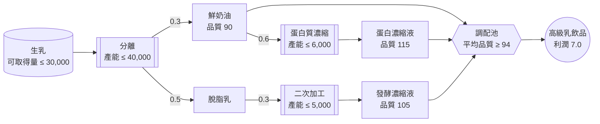
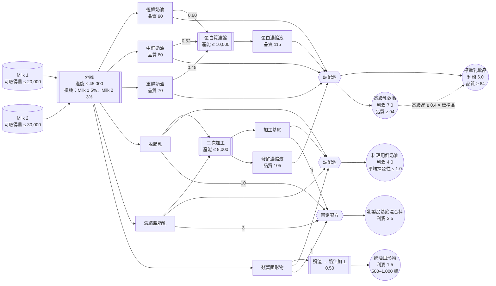

# 1. 使用 Gurobi Modeler 建立最佳化模型

如果您以前建立過最佳化模型，大概都是先手寫數學式，再一行一行地轉換成 `gurobipy`。在本實作中，您將改用
**Gurobi Intelligence Hub** 中的 AI 代理：您以自然語言描述問題，代理就會帶著您從模型規格說明一路走到
`gurobipy` 實作及其測試。

> ⚠️ 本文件中沒有需要執行的程式碼。所有建模工作都在網頁瀏覽器中的
> **[intelligence.gurobi.com](https://intelligence.gurobi.com)** 進行。
> 本文件提供問題描述、逐步指引，以及可用來核對成果的預期結果。

---

## 什麼是 Intelligence Hub？

Gurobi Intelligence Hub 是一項網路服務，將 Gurobi 的各個 AI 代理整合在同一個地方。

| 代理 | 狀態 | 角色 |
|---|---|---|
| **Gurobot** | GA | 隨時待命的專家，解答 Gurobi 產品、語法與授權相關問題 |
| **Modeler** | Beta | 引導您從商業問題描述走到經過驗證的 `gurobipy` 程式碼 |
| **Explainer** | Experimental | 診斷並解讀既有的模型實例（將在下一個實作中使用） |

所有回答都以 Gurobi 官方文件、範例與最佳實務為依據，而且對話與檔案依工作階段（session）彼此隔離。

## 什麼是 Modeler？

**Modeler** 是一個建模助理，會一步步帶您從問題描述走到經過驗證、可執行的 `gurobipy` 程式碼。

- **對話式規格說明**：它會一次問一個問題，詢問目標、限制式、輸入/輸出與測試情境，直到規格說明完整為止。
- **以商業為核心的工作流程**：讓您專注於實際的商業問題，而不是數學。
- **以驗收測試驅動的驗證**：它會根據規格說明產生 pytest 測試情境、執行測試、檢查通過/失敗，必要時自行修正模型。
- **反覆迭代的設計**：問題改變時，您只要更新規格說明，AI 就會把變更一路帶進模型與測試中。

> 💡 **注意**：Modeler 能幫助您建立*正確*的模型，但不保證是*效能最好*的模型。不要盲目相信 AI
> 產生的模型——請養成像下方暖身練習那樣，以小型驗收測試檢查模型的習慣。

## 實作目標

本實作分為三個部分。

- **Part 0. 暖身**：交給 Modeler 一個您已知答案的問題，體會如何信任並驗證 AI 建立的模型。
- **Part 1. 主要實作**：向 Modeler 描述一個簡化的問題——一座只生產單一高級乳飲品的乳品廠——建立一個**使總利潤最大化的生產規劃模型**，並求得**可行的最佳解**。約 30 分鐘可以完成。
- **附錄. 完整製程模型**：同一座工廠的更貼近現實版本。若有時間或想挑戰更大的問題，不妨試試——下一個實作（`2_Explainer`）會直接沿用這個附錄模型。

## Part 0. 暖身——用您已知答案的問題驗證 Modeler

在處理新問題之前，先給 Modeler 一個**最佳解已知的問題**，並將其結果與該答案比較。如 Modeler
介紹中所強調的，建立對 AI 產生模型之信任的方法，就是先在您能自行驗證的小問題上檢查它。

**問題**：經典的多期生產與存貨規劃問題（12 個月、單一產品）。已知其最佳總成本為 **4,250**。

每月需求、單位生產成本、存貨持有成本與產能都提供於
[`data/production_planning.csv`](../data/production_planning.csv)
（欄位：`month`、`demand`、`production_cost`、`holding_cost`、`production_capacity`）。

### Modeler 提示詞範例

將下方提示詞貼到 Intelligence Hub 的對話框，並附加 `production_planning.csv`。
（請先試著用自己的話描述問題，卡住時再展開這段內容。）

顯示提示詞

> 我想最佳化我們工廠未來 12 個月的生產與存貨計畫。
>
> 我們每個月生產單一產品，存放於庫存中，並以庫存來滿足每個月的需求。
>
> 每個月都有最大生產量（產能），生產量不能超過這個上限。每生產一單位都會產生生產成本，每一單位留在庫存中
> 未售出的產品則會產生每月存貨持有成本。兩種成本都隨月份而不同。
>
> 存貨會從上個月結轉，加上本月的生產量，再扣除本月的需求。第一個月的期初存貨為零，且存貨永遠不能為負。
>
> 每月需求、單位生產成本、存貨持有成本與產能都在附加的 CSV 檔案（`production_planning.csv`）中。
>
> 請建立一個每月生產計畫，使整整 12 個月的總成本——生產成本加上存貨持有成本——最小化。

### 步驟

1. 在 Intelligence Hub 中將上述提示詞傳送給 **Modeler**，並附加 `production_planning.csv`。
2. 逐一回答 Modeler 為了精煉規格說明而提出的問題（例如：生產量是整數還是連續值、規劃期末的存貨要求、
   未滿足需求如何處理）。
3. 規格說明完成後，詢問類似「**請先給我看數學模型**」的問題，確認 Modeler 寫出的集合、變數、目標函數與限制式
   符合您用文字描述的內容。
4. 接著詢問「**請用 gurobipy 實作，並以附加的 CSV 資料進行最佳化**」，讓它產生並執行程式碼。
5. 將**總成本**（目標值）以及每月生產量與存貨量與下方的已知答案比較。
6. 若結果不同，請透過與 Modeler 的對話找出哪裡不同、為什麼不同（整數或連續生產量、存貨平衡式中期初存貨的
   處理方式等），並請它修正模型。

### 暖身預期結果

| 項目 | 已知答案 | Modeler 結果 |
|---|---|---|
| 目標值（總成本，最小化） | 4,250.00 | **4,250.00**（應一致） |
| 1 月生產量 / 存貨 | 40 / 0 | 40 / 0 |
| 7 月生產量 / 存貨 | 100 / 10 | 100 / 10 |
| 是否一致？ | - | ✅ 一致 |

## Part 1. 主要實作——高級乳飲品生產規劃

既然您已經知道如何與 Modeler 合作，接下來請與 Modeler 一起從零開始，為一個**您還不知道答案的新問題**
建立模型。（這座工廠更貼近現實的版本收錄於本文件末尾的附錄——Part 1 經過簡化，讓您能在 30 分鐘內完成。）

### 商業問題描述

一座乳品廠購買生乳，並生產單一產品：**高級乳飲品**（premium dairy drink）。

分離設備會將生乳分成鮮奶油（cream）與脫脂乳（skim milk）。鮮奶油可以直接用於飲品，或經過
**蛋白質濃縮設備**成為品質更高的蛋白濃縮液（protein concentrate）。脫脂乳不能單獨直接用於飲品；
必須經過**二次加工設備**，轉成可作為飲品原料的發酵濃縮液（fermented concentrate）。

飲品是將這三種原料（鮮奶油、蛋白濃縮液、發酵濃縮液）依體積調配而成，且只有在平均品質指數**至少 94**
時才能販售。（品質指數不是真正的營養標示——它是一個調配時恰好依體積線性平均的分數。例如，將指數 90
與指數 115 的原料等量混合，結果恰好是 102.5。）

| 物料流 | 產出率（桶/桶） | 品質指數 |
|---|---|---|
| 鮮奶油（分離後直接取得） | 0.3（每桶生乳） | 90 |
| 脫脂乳（分離後直接取得） | 0.5（每桶生乳） | 無法直接使用 |
| 蛋白濃縮液 | 0.6（每桶鮮奶油） | 115 |
| 發酵濃縮液 | 0.3（每桶脫脂乳） | 105 |

| 設備 / 資源 | 每日上限 |
|---|---|
| 生乳採購 | 30,000 桶 |
| 分離設備 | 40,000 桶 |
| 蛋白質濃縮設備 | 6,000 桶 |
| 二次加工設備 | 5,000 桶 |

每桶飲品可帶來 **7.0（百美元）** 的利潤。

下圖顯示生乳如何經過分離與加工，最後成為高級乳飲品。箭頭旁的數字是每桶的產出率。

**目標**：建立一個使每日利潤最大化的生產計畫。

### 步驟

Modeler 不會一次接收整個問題描述。它會透過**一次問一個問題**的方式精煉規格說明。

1. 所以不要一開始就把所有內容講完。先簡短開場，再依序回答 Modeler 的問題（製程/產出率、調配規則、
   原料來源、成本、產能上限、銷售條件等）。（實際對話如何進行，請參考下方的「Modeler 對話範例」。）
2. 規格說明完成後，詢問類似「**請先給我看數學模型**」的問題，確認 Modeler 寫出的集合、變數、目標函數與限制式
   符合您用文字描述的內容。
3. 接著詢問「**請用 gurobipy 實作並執行最佳化**」，讓它產生並執行程式碼。
4. 將**總利潤**（目標值）與各設備的使用量和下方「Part 1 預期結果」比較。
5. 若結果不同，請透過與 Modeler 的對話找出哪裡不同、為什麼不同（物料平衡不等式的方向、品質限制式的方向、
   設備產能限制式等），並請它修正模型。（下方「Modeler 對話範例」的結尾就是一個正好如此的真實案例。）

### Part 1 預期結果

執行 Modeler 所產生之模型的結果。（利潤單位：百美元 = USD 100）

| 項目 | 數值 |
|---|---|
| Optimization Status | OPTIMAL |
| 總利潤（目標值） | **70,210.84** |
| 生乳使用量（≤ 30,000） | 30,000.00（達上限） |
| 蛋白質濃縮設備使用量（≤ 6,000） | ≈ 1,174.70（有餘裕） |
| 二次加工設備使用量（≤ 5,000） | 5,000.00（達上限） |

| 物料流 | 數量（桶） |
|---|---|
| 鮮奶油（直接調配） | ≈ 7,825.30 |
| 蛋白濃縮液 | ≈ 704.82 |
| 發酵濃縮液 | 1,500.00 |
| **高級乳飲品（總產量）** | ≈ 10,030.12 |

> ※ Modeler 產生的變數名稱與實作方式可能與上述不同，但只要規格說明完整反映本文件中的問題描述，最佳值就必定相同。
> 如果您的數值不同，請檢查規格說明或實作中是否遺漏了某條限制式。

### Modeler 對話範例

請依照上方的「步驟」進行。如果您無法想像實際對話會如何進行，可以展開下方的範例。
（請先試著自己主導對話，卡住時再展開。）

顯示對話範例

> **您**：我想最佳化我們乳品廠的每日生產計畫。我們購買生乳，並生產單一的高級乳飲品。你可以幫忙嗎？

Modeler 不會直接跳進規格說明。它會先用一個選擇題來確定目標（例如：「最接近成本最小化 / 營收最大化 /
利潤最大化 / 產量最大化中的哪一個？」）。

> **您**：利潤最大化。製程是這樣的：生乳經過分離設備後，會得到鮮奶油與脫脂乳。每桶生乳可產出 0.3 桶
> 鮮奶油與 0.5 桶脫脂乳；其餘為製程損耗。

Modeler：「飲品的配方是什麼？是固定比例調配，還是只要符合品質標準即可的彈性調配？」

> **您**：我們將鮮奶油、蛋白濃縮液與發酵濃縮液三種原料依體積自由調配，但平均品質指數必須至少達到 94
> 才能販售。鮮奶油本身的品質指數是 90。如果把鮮奶油送進蛋白質濃縮設備，每桶鮮奶油會產出 0.6 桶
> 品質指數 115 的蛋白濃縮液。

Modeler：「發酵濃縮液是怎麼來的？是向外採購，還是由脫脂乳加工製成？也請提供它的品質指數。」

> **您**：脫脂乳不能直接用於飲品。它必須經過二次加工設備，成為品質指數 105 的發酵濃縮液，再用於飲品。
> 每桶脫脂乳可產出 0.3 桶發酵濃縮液。

接著 Modeler 會詢問成本與價格結構。

> **您**：沒有其他個別的成本項目；我們只知道每桶飲品的淨利為 7.0（百美元）。所以只要最大化飲品產量 × 7.0
> 就好。

Modeler：「每天可購買的生乳量，或各設備的處理能力有上限嗎？」

> **您**：兩者都有。我們每天最多可購買 30,000 桶生乳，分離設備每天最多可處理 40,000 桶。蛋白質濃縮設備
> 每天可處理 6,000 桶，二次加工設備每天 5,000 桶。

Modeler 接著會再確認一兩個細節，例如「生產的飲品都能賣得出去嗎？」或「調配比例還有其他限制嗎？」——
就這個問題而言，簡短回答「是的，全部都能賣出，也沒有比例限制——只要品質指數達到 94 即可」就足夠了。

當規格說明看起來已經完整時，先不要要求程式碼——請先檢查數學模型。

> **您**：很好。在實作之前，請先給我看數學模型（集合、變數、目標函數、限制式）。

Modeler 會如下列出完整的數學模型。請逐項與您用文字描述的內容比對。

**決策變數（7 個）**

| 變數 | 意義 |
|---|---|
| $x$ | 每日生乳採購量（桶） |
| $c_b$ | 直接送去調配的鮮奶油 |
| $c_p$ | 送進蛋白質濃縮設備的鮮奶油 |
| $p$ | 蛋白濃縮液產量 |
| $s$ | 送進發酵（二次加工）設備的脫脂乳 |
| $f$ | 發酵濃縮液產量 |
| $b$ | 高級乳飲品產量 |

**目標函數**

$$\max \quad 7.0 \cdot b$$

**限制式**

$$x \leq 30{,}000 \quad \text{(C1: 生乳採購上限)}$$

$$x \leq 40{,}000 \quad \text{(C2: 分離產能——在 C1 之下實際上不會受限)}$$

$$c_p \leq 6{,}000 \quad \text{(C3: 蛋白質濃縮產能)}$$

$$s \leq 5{,}000 \quad \text{(C4: 發酵設備產能)}$$

$$c_b + c_p = 0.3x \quad \text{(C5: 鮮奶油物料平衡)}$$

$$s = 0.5x \quad \text{(C6: 脫脂乳物料平衡)}$$

$$p = 0.6 \cdot c_p \quad \text{(C7: 蛋白濃縮液平衡)}$$

$$f = 0.3 \cdot s \quad \text{(C8: 發酵濃縮液平衡)}$$

$$b = c_b + p + f \quad \text{(C9: 飲品產量平衡)}$$

$$-4 \cdot c_b + 21 \cdot p + 11 \cdot f \geq 0 \quad \text{(C10: 品質要求的線性化 } \tfrac{90c_b+115p+105f}{b}\geq 94 \text{)}$$

$$x, c_b, c_p, p, s, f, b \geq 0 \quad \text{(C11: 非負限制)}$$

確認數學模型與您的描述一致後，再請它實作。

> **您**：數學模型看起來沒問題。請用 gurobipy 實作並執行最佳化。

Modeler 執行程式碼的結果：利潤 31,500（百美元）、高級乳飲品 4,500 桶、生乳採購 10,000 桶（只有 30,000
上限的 1/3），而二次加工設備以滿載的 5,000 桶運轉。

> **您**：等等，生乳採購量沒有達到上限（30,000 桶）？我們不能只處理二次加工設備能負荷的脫脂乳量，
> 其餘直接丟棄嗎？脫脂乳不必 100% 全部加工。

Modeler 重新檢查後發現，**上述數學模型中的 C5 與 C6 被寫成了等式，而不是不等式**（`c_b + c_p = 0.3x`、
`s = 0.5x`）。換句話說，一條「分離出的鮮奶油與脫脂乳必須全部用完」的限制式，在不知不覺中混進了規格說明。
其他限制式（C1–C4、C7–C11）維持不變，只將 C5 與 C6 從等式（`=`）改為不等式（`≤`，也就是「最多可使用
產出的量，但不必全部用完」）：

$$c_b + c_p \leq 0.3x \quad \text{(C5 修正: 鮮奶油物料平衡——多餘鮮奶油可丟棄)}$$

$$s \leq 0.5x \quad \text{(C6 修正: 脫脂乳物料平衡——多餘脫脂乳可丟棄)}$$

修正並重新最佳化後的新結果：利潤 70,210.84、高級乳飲品 10,030 桶、生乳採購 30,000 桶（達上限）。

> ※ 在您自己的工作階段中，Modeler 提問的順序與確切用語可能與上述範例不同。重要的是流程——依序補齊
> 「目標 → 製程/產出率 → 品質限制式 → 產能限制式 → 銷售條件」——而不是確切的措辭。不過，上述對話的
> 最後一段（生乳未達上限）是我們準備本文件時實際遇到的情況。不要照單全收 Modeler 的模型：請養成檢查
> 是否有任何設備使用量低得可疑的習慣。

---

## 附錄. 完整乳品廠製程模型

Part 1 是這座工廠的高度簡化版本。實際上生乳有**兩種**，鮮奶油分為**三個等級**（輕、中、重），
最終產品有**五種**（標準/高級乳飲品、料理用鮮奶油、乳製品基底混合料、奶油固形物）。以下是完整版本。

> 📌 下一個實作（`2_Explainer`）**會直接沿用這個附錄模型**。若有時間或想挑戰更大的問題，請自己用
> Modeler 建立它。即使不建立，也請讀一遍下方的問題描述——這是下一個實作所需的背景知識。

### 商業問題描述

一家乳品加工商向不同供應商購買**兩種生乳**（Milk 1、Milk 2），經過以下**四階段製程**，生產**五種**
利潤率各不相同的**消費性乳製品與原料**。

1. 分離（Separation）——將生乳分成 6 種成分：3 種等級的鮮奶油 + 2 種脫脂物料流 + 殘渣
2. 蛋白質濃縮（Protein Concentration）——將鮮奶油轉為高品質的蛋白濃縮液
3. 二次加工（Secondary Processing）——將脫脂物料流轉為加工基底與發酵濃縮液
4. 產品調配（Product Blending）——將上述原料調配成五種最終產品

> 💡 先說明一個關鍵概念。下方的**品質指數**並不是真正的營養標示（脂肪或蛋白質含量）；它是一個
> **調配時恰好依體積平均的抽象分數**（例如，將指數 90 與指數 70 的原料等量混合，結果恰好是 80）。
> 可飲用的乳製品只有在此指數達到門檻（84 或 94）時才能販售，但生乳分離所得的鮮奶油只有 70–90。
> 因此第 2、3 階段使用專用設備，將鮮奶油與脫脂乳進一步加工成指數 105–115 的高品質原料——但這些
> 設備每天的處理能力是固定的，所以「要加工多少來提升品質」正是整個問題的核心取捨。

**第 1 階段——分離**：生乳經由離心與過濾分成 6 種成分。每桶生乳的產出率（含製程損耗，Milk 1 約 5%、
Milk 2 約 3%）與三種等級鮮奶油的品質指數如下。（脫脂物料流不能直接用於可飲用產品，殘渣則是離心後剩下的
固體殘留物。）

| 成分 | Milk 1 產出率 | Milk 2 產出率 | 品質指數 |
|---|---|---|---|
| 輕鮮奶油（Light Cream） | 0.10 | 0.15 | 90 |
| 中鮮奶油（Medium Cream） | 0.20 | 0.25 | 80 |
| 重鮮奶油（Heavy Cream） | 0.20 | 0.18 | 70 |
| 脫脂乳（Skim Milk） | 0.12 | 0.08 | 無法直接使用 |
| 濃縮脫脂乳（Concentrated Skim） | 0.20 | 0.19 | 無法直接使用 |
| 殘留固形物（Residual Solids） | 0.13 | 0.12 | —（僅用於奶油加工） |

**第 2 階段——蛋白質濃縮**：三種鮮奶油可以直接進入調配，或經過**蛋白質濃縮設備**（超過濾——利用細密薄膜
濾除水分以濃縮蛋白質的製程）成為品質指數 **115** 的高蛋白濃縮液。

| 投入 | 蛋白濃縮液產出率（桶/桶） |
|---|---|
| 輕鮮奶油 | 0.60 |
| 中鮮奶油 | 0.52 |
| 重鮮奶油 | 0.45 |

**第 3 階段——二次加工**：脫脂乳與濃縮脫脂乳可以直接進入調配，或經過**二次加工設備**成為加工基底
（processed base）與發酵濃縮液（以乳酸菌發酵的濃縮液，品質指數 **105**）。殘留固形物則可另外加工成
奶油當量固形物。

| 投入 | 加工基底產出率 | 發酵濃縮液產出率 |
|---|---|---|
| 脫脂乳 | 0.68 | 0.28 |
| 濃縮脫脂乳 | 0.75 | 0.20 |

| 投入 | 奶油固形物產出率 |
|---|---|
| 殘留固形物 | 0.50 |

**第 4 階段——調配**：上述原料調配成五種最終產品。所有調配後的指數（品質指數、揮發性指數）都與上方提示框
中的計算方式相同（依體積線性平均）。

| 產品 | 調配原料 | 品質 / 限制 |
|---|---|---|
| 高級乳飲品（Premium Dairy Drink） | 3 種鮮奶油 + 蛋白濃縮液 + 發酵濃縮液（自由調配） | 品質指數 ≥ 94 |
| 標準乳飲品（Standard Dairy Drink） | 同上 | 品質指數 ≥ 84；高級品產量 ≥ 0.4 × 標準品產量 |
| 料理用鮮奶油（Cooking Cream） | 脫脂乳 + 濃縮脫脂乳 + 加工基底 + 殘渣（自由調配） | 揮發性指數 ≤ 1.0（見下表） |
| 乳製品基底混合料（Dairy Base Mix） | 脫脂乳 : 加工基底 : 濃縮脫脂乳 : 殘渣 = 10 : 4 : 3 : 1（固定比例） | — |
| 奶油固形物（Butter Solids） | 加工後的殘渣 | 每日產量 500 – 1,000 桶 |

| 料理用鮮奶油原料 | 揮發性指數 |
|---|---|
| 脫脂乳 | 1.0 |
| 濃縮脫脂乳 | 0.6 |
| 加工基底 | 1.5 |
| 殘渣 | 0.05 |

**每日設備與資源上限**

| 設備 / 資源 | 每日上限 |
|---|---|
| Milk 1 採購 | 20,000 桶 |
| Milk 2 採購 | 30,000 桶 |
| 分離設備 | 45,000 桶 |
| 蛋白質濃縮設備 | 10,000 桶 |
| 二次加工設備 | 8,000 桶 |

**利潤貢獻（每桶，單位為百美元）**

| 產品 | 利潤 |
|---|---|
| 高級乳飲品 | 7.0 |
| 標準乳飲品 | 6.0 |
| 料理用鮮奶油 | 4.0 |
| 乳製品基底混合料 | 3.5 |
| 奶油固形物 | 1.5 |

下圖顯示從兩種生乳經過分離與加工，到五種最終產品的完整流程。物料流旁的數字是每桶的產出率，各最終產品
必須滿足的限制式標示在其節點內（虛線表示跨兩種不同產品的限制式，例如高級品與標準品飲品之間的比例限制式）。

**目標**：建立一個使上述五種最終產品總利潤最大化的每日生產計畫。

### 步驟

與 Part 1 相同，Modeler 不會一次接收整個問題描述。它會透過**一次問一個問題**的方式精煉規格說明。

1. 不要一次把上方的「商業問題描述」全部講完。先簡短開場，再依序回答 Modeler 的問題（各生乳的分離產出率、
   蛋白質濃縮與二次加工、五種產品各自的調配方式、產能上限、銷售條件等）。（實際對話如何進行，請參考下方的
   「Modeler 對話範例」。）
2. 規格說明完成後，詢問類似「**請先給我看數學模型**」的問題，確認 Modeler 寫出的集合、變數、目標函數與限制式
   符合您用文字描述的內容。
3. 接著詢問「**請用 gurobipy 實作並執行最佳化**」，讓它產生並執行程式碼。
4. 將**總利潤**（目標值）與各產品的產量和下方「附錄預期結果」比較。特別注意以下容易遺漏的項目：
   - 五種最終產品（高級/標準乳飲品、料理用鮮奶油、乳製品基底混合料、奶油固形物）都有對應的變數
   - 奶油固形物產量介於 500 到 1,000 桶之間
   - 高級乳飲品 ≥ 0.4 × 標準乳飲品成立
   - Milk 1 使用量 ≤ 20,000 且 Milk 2 使用量 ≤ 30,000
5. 若結果不同，請透過與 Modeler 的對話找出哪裡不同、為什麼不同（物料平衡不等式的方向、調配與比例限制式、
   品質與揮發性限制式、設備產能限制式等），並請它修正模型。
6. 下一個實作（`2_Explainer`）會直接沿用這個模型，因此請在程式碼結尾加上 `model.write("moodel.lp")`，
   執行後保留所產生的 LP 檔案。

### 附錄預期結果

執行 Modeler 所產生之模型的結果。（利潤單位：百美元 = USD 100）

| 項目 | 數值 |
|---|---|
| Optimization Status | OPTIMAL |
| 總利潤（目標值） | **211,365.13** |
| Milk 1 使用量（≤ 20,000） | 15,000.00（有餘裕） |
| Milk 2 使用量（≤ 30,000） | 30,000.00（達上限） |

| 最終產品 | 產量（桶） | 利潤貢獻（百美元） |
|---|---|---|
| 高級乳飲品 | 6,817.78 | 47,724.45 |
| 標準乳飲品 | 17,044.45 | 102,266.68 |
| 料理用鮮奶油 | 15,156.00 | 60,624.00 |
| 乳製品基底混合料 | 0.00 | 0.00 |
| 奶油固形物 | 500.00 | 750.00 |

> ※ Modeler 產生的變數名稱與實作方式可能與上述不同，但只要規格說明完整反映本文件中的問題描述，最佳值就必定相同。
> 如果您的數值不同，請檢查規格說明或實作中是否遺漏了某條限制式。

### Modeler 對話範例

以下是一段真實的完整工作階段：透過呼叫 Intelligence Hub 的 Modeler API，從零開始為這個問題建立模型
（措辭略經潤飾；問答的順序與內容與實際工作階段相同）。請先試著自己主導對話，卡住時再展開。

顯示對話範例

> **您**：我想最佳化我們乳品加工事業的每日生產計畫。我們購買兩種生乳，生產五種最終產品。你可以幫忙嗎？

Modeler 不會直接跳進規格說明。它會先用一個選擇題來確定目標（「最接近利潤最大化 / 成本最小化 / 產量最大化 /
其他中的哪一個？」）。

> **您**：利潤最大化（沒有生乳採購成本——只考慮銷售利潤）。我們購買 Milk 1 與 Milk 2 兩種生乳。分離設備
> 會將它們分成 6 種成分：輕、中、重鮮奶油、脫脂乳、濃縮脫脂乳與殘渣。（附上各生乳的產出率與品質指數表——
> 並說明品質指數是依體積線性平均。）

Modeler：「5 種最終產品是什麼？請告訴我每種產品使用哪些成分，以及單價（每桶售價）。」

> **您**：首先，分離之後還有兩個加工階段：蛋白質濃縮設備（鮮奶油 → 品質指數 115 的蛋白濃縮液，每日上限
> 10,000 桶）與二次加工設備（脫脂物料流 → 加工基底 + 發酵濃縮液，每日上限 8,000 桶）。殘渣直接加工成
> 奶油固形物。接下來是 5 種最終產品：高級/標準乳飲品（自由調配 + 品質指數限制式 + 40% 比例限制式）、
> 料理用鮮奶油（自由調配 + 揮發性指數限制式）、乳製品基底混合料（10:4:3:1 固定比例），以及奶油固形物
> （500–1,000 桶範圍）。（附上產出率、品質與利潤數據。）

Modeler：「分離出的成分若有未使用的剩餘量，要如何處理？請選擇：**允許丟棄** / 必須全部使用 /
丟棄會產生成本 / 依成分而定。」

> 💡 **補充說明**：這個問題是對話中的關鍵分岔點——正是您在 Part 1 遇到的問題（「分離出的鮮奶油與脫脂乳
> 必須全部用完嗎？」），而這次 Modeler 在實作之前就先問了。

> **您**：允許丟棄。任何階段——分離、蛋白質濃縮或二次加工——的剩餘量都可以直接丟棄；不需要強制全部使用。

Modeler：「對於有多種用途的成分（例如殘渣），可以在這些用途之間自由分配嗎？」

> **您**：可以，自由分配。3 種鮮奶油、脫脂物料流與殘渣，都可以依最佳化的需要任意分配到各種用途
> （直接調配、進一步加工、其他最終產品）。

Modeler：「高級品/標準品/料理用鮮奶油/乳製品基底混合料是否另有最低/最高產量限制？」

> **您**：沒有。我提過的「高級品 ≥ 0.4 × 標準品」比例限制式，以及奶油固形物 500–1,000 桶的範圍，是唯一
> 與產量相關的限制式。另外也可以假設所有產出都能賣出。

當規格說明看起來已經完整時，先不要要求程式碼——請先檢查數學模型。

> **您**：在實作之前，請先給我看數學模型（集合、變數、目標函數、限制式）。

以下是 Modeler 產生的數學模型（集合：$K$ = 3 種鮮奶油 {LC, MC, HC}，$S$ = 脫脂物料流
{SM, CS}，$M$ = {Milk1, Milk2}）。

**決策變數**

| 變數 | 意義 |
|---|---|
| $x_m$ | 生乳 $m$ 的採購量 |
| $u^{blend}_k,\ u^{PC}_k$ | 直接送去調配 / 送進蛋白質濃縮設備的鮮奶油 $k$ |
| $w^{blend}_s,\ w^{SP}_s$ | 直接送去調配 / 送進二次加工設備的脫脂物料流 $s$ |
| $r^{CC},\ r^{DBM},\ r^{BS}$ | 分配給料理用鮮奶油 / 乳製品基底混合料 / 奶油加工的殘渣 |
| $b^{PRE}_i,\ b^{STD}_i$ | 調配進高級/標準乳飲品的原料 $i$ 數量（$i \in \{LC,MC,HC,PC,FC\}$） |
| $b^{CC}_i,\ b^{DBM}_i$ | 調配進料理用鮮奶油 / 乳製品基底混合料的原料 $i$ 數量 |
| $\lambda$ | 乳製品基底混合料固定比例（10:4:3:1）的尺度變數 |
| $\text{Vol}_p$ | 最終產品 $p$ 的總產量（$p \in \{PRE,STD,CC,DBM,BS\}$） |

除了決策變數之外，下方的限制式還使用以下**參數**（固定值）。所有數值都與上方「商業問題描述」中各表格的
數值完全相同。

| 符號 | 意義 | 數值 |
|---|---|---|
| $y_{c,m}$ | 每桶生乳 $m$ 中成分 $c$ 的分離產出率 | 「第 1 階段——分離」表格 |
| $\alpha^{PC}_k,\ \beta^{PB}_s,\ \beta^{FC}_s,\ \alpha^{BS}$ | 鮮奶油 $k$ → 蛋白濃縮液、脫脂物料流 $s$ → 加工基底 / 發酵濃縮液、殘渣 → 奶油固形物的產出率 | 「第 2 · 3 階段」表格 |
| $q_i$ | 調配原料 $i$ 的品質指數（LC 90、MC 80、HC 70、PC 115、FC 105） | 「第 1 · 2 · 3 階段」表格 |
| $v_i$ | 料理用鮮奶油原料 $i$ 的揮發性指數（SM 1.0、CS 0.6、PB 1.5、RS 0.05） | 「第 4 階段——調配」表格 |

**目標函數**

$$\max \quad Z = 7.0\,\text{Vol}&#95;{PRE} + 6.0\,\text{Vol}&#95;{STD} + 4.0\,\text{Vol}&#95;{CC} + 3.5\,\text{Vol}&#95;{DBM} + 1.5\,\text{Vol}&#95;{BS}$$

**限制式**

$$x_{Milk1} \leq 20{,}000, \quad x_{Milk2} \leq 30{,}000 \quad \text{(C1: 生乳採購上限)}$$

$$\textstyle\sum_{m} x_m \leq 45{,}000 \quad \text{(C2: 分離產能)}$$

$$u^{blend}&#95;k + u^{PC}&#95;k \leq \textstyle\sum_{m} y_{k,m}\,x_m \quad \forall k \in K \quad \text{(C3a: 鮮奶油物料平衡——剩餘可丟棄)}$$

$$w^{blend}&#95;s + w^{SP}&#95;s \leq \textstyle\sum_{m} y_{s,m}\,x_m \quad \forall s \in S \quad \text{(C3b: 脫脂物料流物料平衡)}$$

$$r^{CC}+r^{DBM}+r^{BS} \leq \textstyle\sum_{m} y_{RS,m}\,x_m \quad \text{(C3c: 殘渣物料平衡)}$$

$$\textstyle\sum_{k} u^{PC}&#95;k \leq 10{,}000 \quad \text{(C4: 蛋白質濃縮產能)}$$

$$\textstyle\sum_{s} w^{SP}&#95;s \leq 8{,}000 \quad \text{(C5: 二次加工產能)}$$

$$b^{PRE}&#95;k + b^{STD}&#95;k \leq u^{blend}&#95;k \quad \forall k \in K \quad \text{(C6a: 可用於飲品的鮮奶油)}$$

$$b^{PRE}&#95;{PC} + b^{STD}&#95;{PC} \leq \textstyle\sum_{k} \alpha^{PC}&#95;k\,u^{PC}&#95;k \quad \text{(C6b: 可用於飲品的蛋白濃縮液)}$$

$$b^{PRE}&#95;{FC} + b^{STD}&#95;{FC} \leq \textstyle\sum_{s} \beta^{FC}&#95;s\,w^{SP}&#95;s \quad \text{(C6c: 可用於飲品的發酵濃縮液)}$$

$$b^{CC}&#95;s + b^{DBM}&#95;s \leq w^{blend}&#95;s \quad \forall s \in S \quad \text{(C7a: 可用於料理用鮮奶油/DBM 的脫脂物料流)}$$

$$b^{CC}&#95;{PB} + b^{DBM}&#95;{PB} \leq \textstyle\sum_{s} \beta^{PB}&#95;s\,w^{SP}&#95;s \quad \text{(C7b: 可用的加工基底)}$$

$$\textstyle\sum_i (q_i - 94)\,b^{PRE}&#95;i \geq 0 \quad \text{(C8: 高級品品質指數} \geq 94 \text{ 的線性化)}$$

$$\textstyle\sum_i (q_i - 84)\,b^{STD}&#95;i \geq 0 \quad \text{(C9: 標準品品質指數} \geq 84 \text{ 的線性化)}$$

$$\text{Vol}&#95;{PRE} \geq 0.4\cdot\text{Vol}&#95;{STD} \quad \text{(C10: 高級品} \geq 0.4\times\text{標準品比例)}$$

$$\textstyle\sum_i (v_i - 1.0)\,b^{CC}&#95;i \leq 0 \quad \text{(C11: 料理用鮮奶油揮發性指數} \leq 1.0 \text{ 的線性化)}$$

$$b^{DBM}&#95;{SM}=10\lambda,\ \ b^{DBM}&#95;{PB}=4\lambda,\ \ b^{DBM}&#95;{CS}=3\lambda,\ \ b^{DBM}&#95;{RS}=\lambda \quad \text{(C12: DBM 固定比例 10:4:3:1)}$$

$$500 \leq 0.5\,r^{BS} \leq 1{,}000 \quad \text{(C13: 奶油固形物產量 500–1,000 桶)}$$

$$\text{all variables} \geq 0 \quad \text{(C14: 非負限制)}$$

各產品的 $\text{Vol}_p$ **定義**如下，不另編限制式編號（Modeler 實際產生的 `math_formulation.md`
也只將它們標為「Def.」，沒有 Cn 編號）。

$$\text{Vol}&#95;{PRE}=\textstyle\sum_i b^{PRE}&#95;i,\ \ \text{Vol}&#95;{STD}=\textstyle\sum_i b^{STD}&#95;i,\ \ \text{Vol}&#95;{CC}=\textstyle\sum_i b^{CC}&#95;i,\ \ \text{Vol}&#95;{DBM}=18\lambda,\ \ \text{Vol}&#95;{BS}=0.5\,r^{BS}$$

此外，$b^{CC}&#95;{RS}$ 與 $b^{DBM}&#95;{RS}$（實際調配進料理用鮮奶油/DBM 的殘渣）分別不能超過
$r^{CC}$ 與 $r^{DBM}$（分配給各自的殘渣）。這個關係已經包含在 C3c 中，因此不再另列為獨立的限制式。

> 💡 **補充說明**：請注意，成分可用量限制式（C3a–c）是寫成**不等式**。在 Part 1 中，這部分一開始被（錯誤地）
> 寫成「必須全部用完」的等式，導致生乳使用量低於其上限。這一次，Modeler 在實作之前就先問了「剩餘量可以丟棄嗎？」，
> 所以從一開始就是正確的。

> **您**：數學模型看起來沒問題。請用 gurobipy 實作並執行最佳化。

Modeler 產生並執行的程式碼與上方「附錄預期結果」完全一致（總利潤 211,365.13；Milk 1 15,000 / Milk 2 30,000
——達到分離設備 45,000 桶的上限；高級品 6,817.78 : 標準品 17,044.45 = 恰好 0.4；奶油固形物位於其下限 500.00）。

> ※ 在您自己的工作階段中，Modeler 提問的順序與確切用語每次都可能略有不同。重要的是流程——依序補齊
> 「目標 → 生乳/分離 → 鮮奶油與脫脂乳加工 → 調配規則 → 剩餘量處理 → 產能限制式」——而不是確切的措辭。
> 特別是當 Modeler 主動詢問類似「未使用的剩餘量要如何處理？」的問題時，請謹慎回答——在 Part 1 中，這一點
> 從未被明確確認，因而導致了等式/不等式的混淆。

## 下一步

您在附錄中完成的可行模型，會直接帶入下一個實作 `2_Explainer`。在那裡，**行銷團隊悄悄地對這個模型加上了一項新要求**
——如果有一天您的最佳化模型突然變得不可行，您能診斷出原因並提出修正方案嗎？
