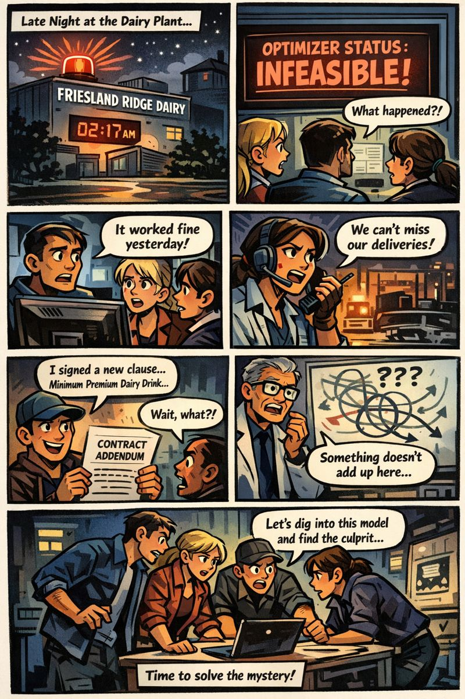
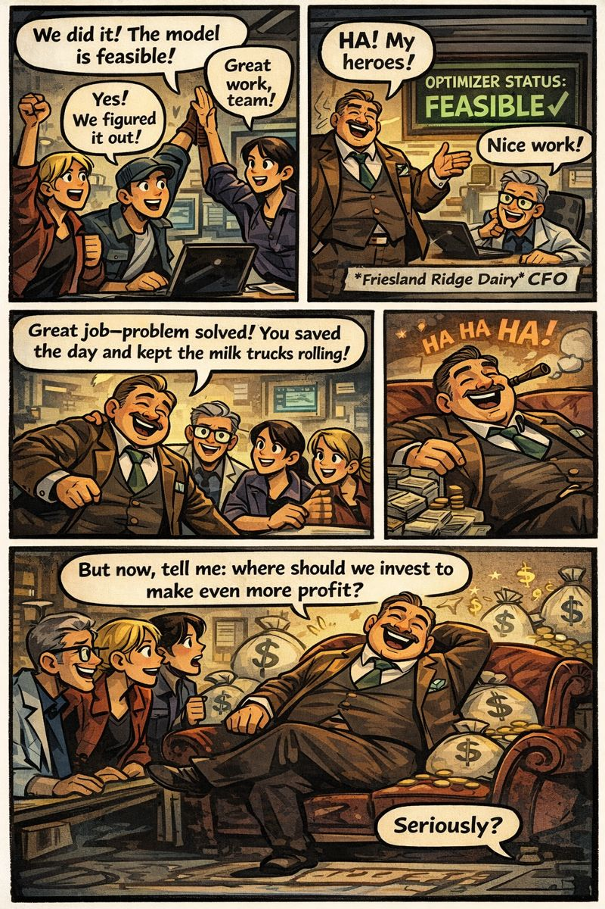

# 2. 使用 Gurobi Explainer 診斷模型

在上一份文件（`1_Modeler` **附錄**）中，您為一座乳品廠建立了生產規劃模型，並得到可行的最佳解。
在本文件中，這個模型出了問題，您將使用 **Explainer** 診斷原因、計算需要鬆弛多少，並分析在哪裡投資
最能提升利潤。

> ⚠️ 本文件同樣沒有需要執行的程式碼。所有診斷工作都在
> **[intelligence.gurobi.com](https://intelligence.gurobi.com)** 上的 **Explainer** 中進行。
> 本文件提供情境、逐步指引，以及可用來核對成果的預期結果。

## 什麼是 Explainer？

**Explainer**（Experimental）是一個代理程式：它接收您上傳的既有模型實例，對其執行 Gurobi 的診斷工具，
並以商業語言解釋結果。Intelligence Hub 提供三種工作流程。

| 工作流程 | 問題範例 | 使用的診斷工具 |
|---|---|---|
| **不可行性診斷（Infeasibility Diagnosis）** | 為什麼我的模型不可行？ | `computeIIS()` |
| **可行性修復（Feasibility Restoration）** | 應該鬆弛哪些限制式？要鬆弛多少？ | `feasRelax()` |
| **敏感度分析（Sensitivity Analysis）** | 哪些限制式／產能對目標函數影響最大？ | 影子價格（`Pi`）、`SARHS` |

> 💡 Explainer 不會把模型和求解器當成「黑盒子」——它會實際將輸入（模型檔案）與輸出（診斷結果）連結起來
> 進行解釋。就像您在上一個實作（`1_Modeler`）中用驗收測試驗證結果一樣，過程中請自行確認 Explainer
> 的解釋與實際數字相符。

## 情境

您是 Friesland Ridge Dairy 的 OR（作業研究）專家。凌晨 02:17，工廠的「Milk Refinery Planning」
最佳化器無法產出計畫。滿載生乳的卡車預定在黎明抵達，供應合約也已經生效——結果發現，行銷團隊悄悄
塞進了一項新的要求。

您的任務是對 MOOdel（Milk Operations Optimization——在 `1_Modeler` 中建立的模型）進行除錯，以便：

1. 找出不可行的原因，並向廠長提出修改建議，
2. 量化模型最少必須鬆弛多少，以及
3. 提出能進一步提升利潤的未來設備投資方案。

## 本實作使用的檔案

行銷團隊在您於上一個實作（`1_Modeler`）中建立的可行模型裡，悄悄加入了以下要求：

> **「每天至少生產 20,000 桶高級乳飲品（Premium Dairy Drink）。」**

加入此要求後（現在已不可行）的模型是 [`models/moodel.lp`](../models/moodel.lp)。請下載它，並在整個實作中使用。

- 若您在 GitHub 上瀏覽：請使用上方連結，或從儲存庫中的 `models/moodel.lp` 下載原始檔案。
- 若您已 clone 儲存庫：檔案已位於 `models/moodel.lp`。

> 📌 您也可以自行建立相同的檔案：在 `1_Modeler` 中建立的模型加入限制式
> `Minimum_Premium: end_prod[Premium_drink] >= 20000` 即可。
> （使用 `model.write("moodel.lp")` 儲存 LP 檔案。）

## Part 1. 不可行性診斷——為什麼不可行？（Q1）

### 步驟

1. 啟動 Explainer，選擇 **Infeasibility Diagnosis** 分頁。
2. 上傳 `moodel.lp`。
3. 問題範例：*「告訴我這個模型為什麼不可行。」*
4. 檢視 Explainer 回報的 **IIS**（不可約不一致子系統（Irreducible Inconsistent Subset）——一組無法再
   縮減、彼此衝突的最小限制式與界限集合）。

### 任務

根據 Explainer 的回答，列出可能造成不可行的候選限制式／界限，並說明每一項為何會造成問題。如同原始
挑戰，廠長（您的講師）只允許調整其中 **一項** 候選——**也就是剛剛新增的那項要求**。您猜得出是哪一條
限制式嗎？

### 預期結果

- IIS 中的限制式：**19**
- IIS 中的界限：**9**（8 個下界、1 個上界）
- 不可行的根本原因：

  新增的 `Minimum_Premium` 限制式（高級品最低產量 20,000 桶）與高級乳飲品的品質標準（品質指數 ≥ 94）
  正面衝突。要達到 94，需要大量高品質原料——蛋白濃縮液（品質 115）與發酵濃縮液（品質 105）——但兩者分別
  受到 **蛋白質濃縮設備**（每天 10,000 桶）與 **二次加工設備**（每天 8,000 桶）的產能限制。即使兩套
  設備都滿載運轉，也無法產出足夠的高品質原料，讓全部 20,000 桶都達到品質標準，因此模型變得不可行。

  → 實體產能（分離、蛋白質濃縮、二次加工）與品質標準（84、94）反映的是工廠實際的設備與合約條件，無法
  更改。然而 `Minimum_Premium` 是行銷團隊剛加入的目標，因此它最有可能是廠長允許您調整的候選項目。

### Explainer 回應範例

如果您無法想像會得到什麼樣的回應，可以展開下方範例。（請先自行向 Explainer 提問並閱讀 IIS，卡關時再
展開。以下是透過 API 直接上傳 `moodel.lp` 並提出相同問題所得到的實際回應。）

顯示回應範例

> **您**：告訴我這個模型為什麼不可行。

Explainer 執行 `computeIIS()`，並將 IIS 中的限制式與界限分組如下。

| 群組 | 包含的限制式／界限 | 說明 |
|---|---|---|
| 最低產量要求 | `Minimum_Premium` | 要求 Premium_drink 至少 20,000 單位 |
| 品質要求 | `Quality_tol_premium_drink`（及另外 1 項） | 要求 Premium_drink 品質指數 ≥ 94 → 需要足夠的高品質中間產物（蛋白濃縮液、發酵濃縮液） |
| 製程產能限制 | `Protein_conc_cap`（≤ 10,000）、`Secondary_proc_cap`（≤ 8,000） | 生產這些高品質中間產物的兩套設備之加工上限 |
| 原料投入上限 + 物料流平衡 | `milk_in[2]`（UB = 30,000）以及分離／調配的平衡等式 | 上游的生乳供應本身決定了中間產物產量的上限 |

> 簡而言之：「要生產 20,000 單位高品質（94 以上）的 Premium_drink，需要足夠的高品質中間產物，但設備
> 產能限制與生乳投入上限使其無法達成。」

接著，Explainer 依優先順序提出鬆弛選項。

1. **提高製程產能限制**——調高 `Protein_conc_cap` 與 `Secondary_proc_cap` 的 RHS（擴充設備）
2. **提高生乳投入上限**——調高 `milk_in[2]` 的 UB
3. **放寬最低產量／品質標準**——調整 `Minimum_Premium` 或 `Quality_tol_premium_drink`

## Part 2. 可行性修復——最小鬆弛量是多少？（Q2）

您已經找到原因，但「就當那項要求從沒發生過」並不是答案。行銷團隊和廠長都不打算完全放棄它。因此下一個
問題是：「我們需要把它降低多少？」

### 步驟

1. 在 Explainer 中選擇 **Feasibility Restoration** 分頁，並上傳同一個 `moodel.lp`。
2. 廠長表示：「只有剛加入的高級品最低產量要求可以調整。其他實體產能與品質標準都沒有商量餘地。」
3. 問題範例：*「如果只鬆弛高級品最低產量要求，需要降低多少才能讓模型可行？」*
4. 檢視 Explainer 基於 `feasRelax` 的回答。Explainer 會在回答中附上 **鬆弛後的模型檔案**（例如
   `moodel_repaired.lp`）——請下載它，Part 3 會再用到。

### 預期結果（利潤單位：百美元（USD 100））

- 最小鬆弛量（桶）：**≈ 990.76**
- 鬆弛後的高級品最低產量（桶）：**≈ 19,009.24**（20,000 → 19,009.24）
- 總利潤：**185,746.56**

| 產品 | 產量 | 總利潤 |
|---|---|---|
| 高級乳飲品 | 19,009.24 | 133,064.69 |
| 標準乳飲品（Standard Dairy Drink） | 0.00 | 0.00 |
| 料理用鮮奶油（Cooking Cream） | 12,982.97 | 51,931.86 |
| 乳製品基底混合料（Dairy Base Mix） | 0.00 | 0.00 |
| 奶油固形物（Butter Solids） | 500.00 | 750.00 |

> ※ Explainer 顯示的小數位數或措辭可能不同，但關鍵數字（鬆弛量 ≈ 990.8 桶、總利潤 ≈ 185,746.6）必須與
> 上述一致。利潤低於 `1_Modeler`（211,365.13），是因為原本會投入其他高毛利產品（例如標準乳飲品）的原料，
> 被挪去滿足高級乳飲品的要求。

### Explainer 回應範例

如果您無法想像會得到什麼樣的回應，可以展開下方範例。（請先自行向 Explainer 提問，卡關時再展開。以下是
延續 Part 1 同一個 API 工作階段所得到的實際回應。）

顯示回應範例

> **您**：只有剛加入的高級品最低產量要求（`Minimum_Premium`）可以調整；其他實體產能與品質標準都沒有
> 商量餘地。如果只鬆弛高級品最低產量要求，需要降低多少才能讓模型可行？

Explainer 執行 `feasRelax`，用 Gurobi 重新求解修復後的模型以驗證可行性，然後回報：

| 項目 | 目前值 | 鬆弛後的最大值 | 需要的降低量 |
|---|---|---|---|
| `Minimum_Premium` RHS | 20,000 單位 | **19,009.24 單位** | ≈ 990.76 單位 |

> 在維持所有現有實體限制（製程產能、品質標準、生乳投入上限）的情況下，Premium_drink 可達到的最大產量為
> 19,009 單位。以現有設備與原料條件無法達成原本 20,000 單位的目標，因此建議將要求調整為 19,009 單位
> 以下。

修復後的模型（`moodel_repaired.lp`）目標值為 **185,746.56**，最後 Explainer 會詢問您接下來是否要對修復後
的模型進行敏感度分析。

## Part 3. 敏感度分析——應該投資在哪裡？（Q3）

問題並未就此結束。工廠重新運轉了，但財務長馬上追問——*「不過現在告訴我：我們該投資在哪裡，才能賺更多錢？」*

### 步驟

1. 在 Explainer 中選擇 **Sensitivity Analysis** 分頁，並上傳 Part 2 修復（鬆弛）後的模型。（若您在
   Part 2 沒有取得檔案，請改用 [`models/moodel_repaired.lp`](../models/moodel_repaired.lp)。）
2. 問題範例：*「擴充哪一套設備的產能最能提升利潤？能提升多少？最多可以擴充到多少？」*
3. 確認以下三條產能限制式的 **影子價格** 與 **有效範圍**：
   - 最大分離產能：每天 45,000 桶
   - 蛋白質濃縮產能：每天 10,000 桶
   - 二次加工產能：每天 8,000 桶

### 預期結果

| 設備 | 影子價格（百美元／桶·天） | 有效範圍（上限） |
|---|---|---|
| 分離產能 | 0.00（非緊限制） | 不適用 |
| 蛋白質濃縮產能 | **74.50** | 至每天 ≈ 10,301 桶（+301 桶） |
| 二次加工產能 | **16.35** | 至每天 ≈ 9,444 桶（+1,444 桶） |

**投資優先順序**：優先擴充 **蛋白質濃縮設備**。它每桶的邊際利潤（74.50）約為二次加工設備（16.35）的
**4.6 倍**，投資報酬最佳。但請注意，此影子價格僅在目前的最佳基底維持不變時成立（至每天 +301 桶）；超過
此範圍的擴充需要重新進行敏感度分析。分離產能已有餘裕（影子價格 0），因此不是投資優先項目。

### Explainer 回應範例

如果您無法想像會得到什麼樣的回應，可以展開下方範例。（請先自行向 Explainer 提問，卡關時再展開。以下是
在 Part 1、2 的同一個工作階段中，直接上傳 Part 2 修復後的模型（`moodel_repaired.lp`）並延續對話所得到的
實際回應。）

顯示回應範例

> **您**：現在對我們剛修復的模型（`moodel_repaired.lp`）進行敏感度分析。擴充哪一套設備的產能最能提升
> 利潤？請提供三條產能限制式的影子價格與有效範圍（各自最多可擴充多少）：分離產能（45,000）、蛋白質
> 濃縮產能（10,000）與二次加工產能（8,000）。

Explainer 先給出結論，並整理成投資優先順序表。

| 排名 | 設備 | 影子價格 | 在目前基底內的最大擴充量 | 狀態 |
|---|---|---|---|---|
| **第 1** | 蛋白質濃縮（`Protein_conc_cap`，10,000） | **+74.50／單位** | +301 單位（→ 10,301） | 緊限制（Binding） |
| **第 2** | 二次加工（`Secondary_proc_cap`，8,000） | **+16.35／單位** | +1,444 單位（→ 9,444） | 緊限制（Binding） |
| **無需投資** | 分離（Separation，45,000） | **0** | — | 非緊限制（Non-binding） |

> 影子價格與有效範圍僅在目前的最佳基底維持不變時成立。例如，將蛋白質濃縮設備擴充超過 10,301，或將二次
> 加工設備擴充超過 9,444，基底就會改變，超過該點後的效果需要另行分析。

